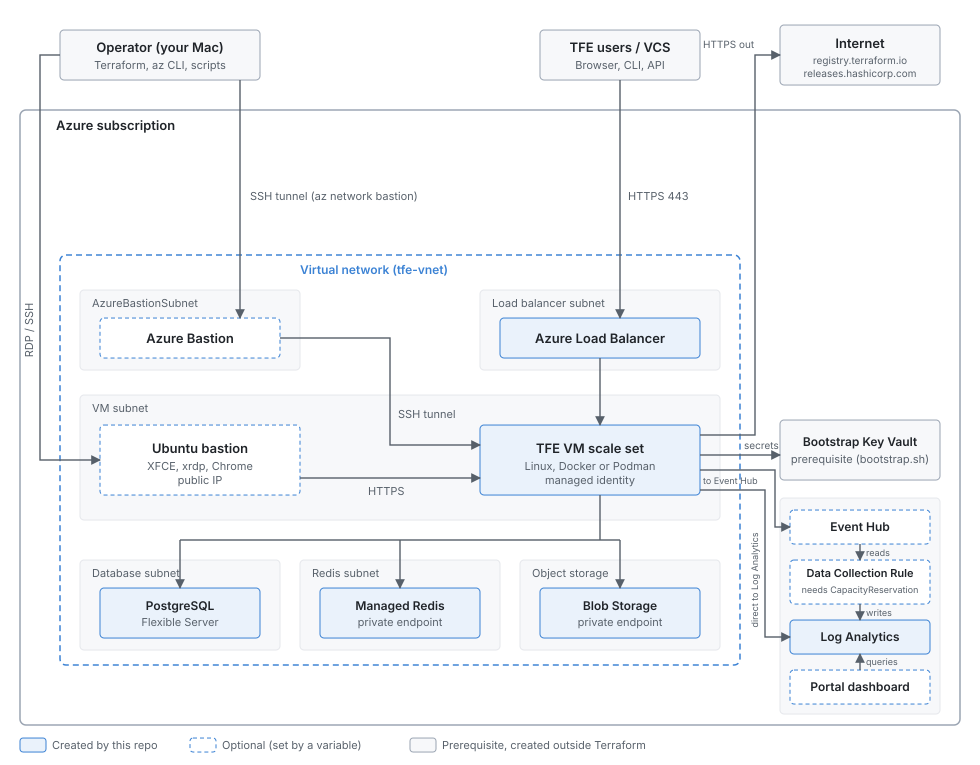

# Terraform Enterprise on Azure

Terraform that deploys Terraform Enterprise (TFE) on Microsoft Azure Virtual Machines, based on the HashiCorp Validated Design (HVD). It defaults to `active-active` [operational mode](https://developer.hashicorp.com/terraform/enterprise/flexible-deployments/install/operation-modes); `external` is also supported. Docker and Podman are the supported container runtimes.



The upstream [HashiCorp reference architecture](docs/images/tfe_on_azure.png) is kept for comparison.

## What this deploys

| Component | Notes |
|---|---|
| TFE on a Linux VM scale set | Behind an Azure Load Balancer (internal or external). Docker or Podman. |
| PostgreSQL Flexible Server | TFE database. |
| Azure Managed Redis | Used for TFE `>= 1.0.1`. Older tags use Azure Cache for Redis. |
| Blob Storage | TFE object storage, over a private endpoint. |
| Networking (optional) | VNet, subnets and Azure Bastion, when `create_networking_resources = true`. |
| Log Analytics, Fluent Bit (optional) | TFE container logs, sent by Fluent Bit straight to Log Analytics (`log_fwd_destination_type = "log_analytics"`) or through an Event Hub. A Portal dashboard can sit on top. |
| Event Hub to Log Analytics (optional) | With `create_event_hub_log_analytics_ingestion = true`, a Data Collection Rule reads the Event Hub and writes to the `tfe_fluent_bit_CL` table, which the dashboard queries. Set `create_event_hub = true` and `create_log_analytics_workspace = true` with it. Known issue: Azure rejects it on a `PerGB2018` workspace; see [Event Hub to Log Analytics](#event-hub-to-log-analytics). |
| Ubuntu bastion (optional) | Desktop browser inside the VNet for the TFE UI. See [Ubuntu bastion](#ubuntu-bastion). |

Created outside this Terraform: the **bootstrap Key Vault** that holds the license, TLS certificate and passwords (made by [`scripts/bootstrap.sh`](scripts/bootstrap.sh)).

Also in this repo, applied after TFE is running:

- [`tf-demo-workspace-config/`](tf-demo-workspace-config/README.md): a demo workspace, the Sentinel policy set from [`sentinel/`](sentinel/README.md), and optional notifications.
- [`test-workspace/`](test-workspace/README.md): a small config used to prove that runs work.

## Prerequisites

- A TFE license file (for example `terraform.hclic`, git-ignored).
- Terraform `>= 1.9` (`>= 1.11` for [`tf-demo-workspace-config/`](tf-demo-workspace-config/README.md)), the `az` CLI (logged in), `ssh`, `jq`.
- An Azure subscription where you can create the resources above.
- A name for TFE (`tfe_fqdn`, for example `tfe.azure.example.com`).
- A bootstrap Key Vault with the TFE secrets. [`scripts/bootstrap.sh`](scripts/bootstrap.sh) creates it and fills it with a self-signed certificate and generated passwords. To use your own certificate, see [TLS certificate rotation](docs/tfe-cert-rotation.md).
- Network access from the VM subnet to the [TFE egress endpoints](https://developer.hashicorp.com/terraform/enterprise/flexible-deployments/install/requirements/network#egress).

If you bring your own network (`create_networking_resources = false`) you also need a VNet with a load balancer subnet, a VM subnet (service endpoints for `Microsoft.KeyVault`, `Microsoft.Sql`, `Microsoft.Storage`), a database subnet delegated to `Microsoft.DBforPostgreSQL/flexibleServers`, and a Redis subnet. Allow these on the subnets:

| Port | Direction |
|---|---|
| `TCP/443` | Users, VCS and CI/CD to the load balancer (internal) or VM subnet (external) |
| `TCP/5432` | VM subnet to database subnet |
| `TCP/6380` | VM subnet to Redis |
| `TCP/8201` | Between TFE VMs (`active-active` only) |
| `TCP/9090`, `TCP/9091` | Optional: metrics scraping |
| `TCP/9443` | Optional: admin console, when `tfe_admin_console_disabled = false` |

## Deploy

Run the commands from the repo root. [`scripts/README.md`](scripts/README.md) explains each script.

1. **Bootstrap the prerequisites.** Edit the names at the top of the script first if yours differ.

   ```bash
   bash tfe-azure/scripts/bootstrap.sh
   ```

2. **Configure.** Copy the example files and fill them in. Secrets go in `.env`, not in tfvars.

   ```bash
   cp tfe-azure/main/terraform.tfvars.example tfe-azure/main/terraform.tfvars
   cp tfe-azure/.env.local.example tfe-azure/.env
   ```

3. **Apply.**

   ```bash
   set -a; source tfe-azure/.env; set +a
   terraform -chdir=tfe-azure/main init
   terraform -chdir=tfe-azure/main apply
   ```

4. **Run the startup script, if needed.** Only when the VM uses a HashiCorp-built image:

   ```bash
   export SSH_KEY=~/.ssh/<private-key>
   bash tfe-azure/scripts/deploy-tfe.sh
   ```

5. **Check the install.** Connect to the VM through the Azure Bastion tunnel (`deploy-tfe.sh` opens one on port `2222`), then:

   ```bash
   tail -f /var/log/tfe-cloud-init.log          # look for: TFE custom_data script finished successfully!
   cd /etc/tfe && sudo docker compose exec tfe tfe-health-check-status
   ```

6. **Create the first admin user** and log in. See [First-time login](#first-time-login).

7. **Configure TFE with Terraform.** See [Configuring TFE from your Mac](#configuring-tfe-from-your-mac).

`terraform -chdir=tfe-azure/main output` lists the useful values: the TFE `url`, resource group, VM scale set name, load balancer IP, Ubuntu bastion IP, dashboard URL and so on.

## First-time login

TFE has no default credentials. Create the first admin account with a one-time IACT (Initial Admin Creation Token).

**1. Get the token** (on your Mac, with the bastion tunnel open):

```bash
ssh -p 2222 -i "$SSH_KEY" tfeadmin@127.0.0.1 \
  "sudo docker exec tfe-tfe-1 tfectl admin token"
```

The token is valid for 60 minutes. If it has expired, add `--reset` to the command.

**2. Create the admin account.** Open Chrome on the [Ubuntu bastion](#ubuntu-bastion) and go to:

```
https://tfe.azure.example.com/admin/account/new?token=<PASTE-TOKEN-HERE>
```

Choose a username, email and password. This becomes the first admin account.

**3. Log in** at `https://tfe.azure.example.com`, then create an organisation from **New organisation**.

> 📝 `tfe_iact_time_limit` sets how long the token is valid (default 60 minutes). `tfe_iact_subnets` restricts which subnets can use it.
>
> 📝 The module switches between `/_health_check` and `/api/v1/health/readiness` based on `tfe_image_tag`, so the load balancer probe matches the deployed TFE version.

## Configuring TFE from your Mac

TFE is not directly reachable from your Mac. [`scripts/run-tf-demo-workspace-config.sh`](scripts/run-tf-demo-workspace-config.sh) opens an SSH SOCKS proxy through the Ubuntu bastion, sets `HTTPS_PROXY=socks5h://…` (Terraform ignores `ALL_PROXY`), runs the command, and closes the proxy.

It runs [`tf-demo-workspace-config/`](tf-demo-workspace-config/README.md), which creates the demo workspace, enables the Sentinel policy set on it, and optionally adds Teams or email notifications.

You need the Ubuntu bastion, an organisation, and a **user** API token (**User Settings** → **Tokens**; not the IACT token). Set the organisation in `tf-demo-workspace-config/terraform.tfvars`.

```bash
export TFE_TOKEN=<your-user-api-token>
bash tfe-azure/scripts/run-tf-demo-workspace-config.sh           # init + plan (default)
bash tfe-azure/scripts/run-tf-demo-workspace-config.sh apply
bash tfe-azure/scripts/run-tf-demo-workspace-config.sh destroy
```

> 📝 Email notifications are only delivered if SMTP is configured in TFE.

## Running the test workspace

[`scripts/run-test-workspace.sh`](scripts/run-test-workspace.sh) is an optional end-to-end check. It copies [`test-workspace/`](test-workspace/main.tf) to the TFE VM through the Azure Bastion tunnel and runs a `random_string` apply against TFE, so a run appears in the UI. It is safe to re-run.

```bash
export SSH_KEY=~/.ssh/<your-private-key>
export TFE_ORG=<your-org-name>           # must already exist
export TFE_TOKEN=<your-user-api-token>   # not the IACT token
bash tfe-azure/scripts/run-test-workspace.sh         # init + apply (default)
bash tfe-azure/scripts/run-test-workspace.sh plan    # init + plan only
```

The script installs Terraform **1.9.8** on the VM, because TFE 1.0.1 is incompatible with CLI `>= 1.10`.

## Ubuntu bastion

An optional Ubuntu VM with an XFCE desktop, xrdp and Google Chrome, for opening the TFE UI in a graphical browser. Enable it in `main/terraform.tfvars`:

```hcl
create_ubuntu_bastion        = true
ubuntu_bastion_allowed_cidrs = ["<your-public-ip>/32"]
# ubuntu_bastion_image_name       = "hc-base-ubuntu-2404-amd64" # default
# ubuntu_bastion_vm_size          = "Standard_D4ds_v5"          # default Standard_D2s_v3
# ubuntu_bastion_tfe_hosts_ip     = "<TFE-VM-IP>"               # default: load balancer IP
# ubuntu_bastion_run_setup_script = false                       # default true; see Notes
```

The password comes from the environment: `TF_VAR_ubuntu_bastion_admin_password` (see `.env.local.example`). You can also set `ubuntu_bastion_ssh_public_key`. The network security group allows TCP 3389 (xrdp) and 22 (SSH) from `ubuntu_bastion_allowed_cidrs` only.

**Connect from your Mac:** get the IP with `terraform -chdir=tfe-azure/main output ubuntu_bastion_public_ip`, then use **Microsoft Remote Desktop** → **Add PC**, username `bastionadmin` and your password. In Chrome, browse to `https://<tfe_fqdn>`.

**Notes**

- `Standard_D2s_v3` may be unavailable in some regions (`SkuNotAvailable`). Choose another size with `ubuntu_bastion_vm_size`.
- By default the setup runs on first boot through cloud-init and takes a few minutes. Progress is in `/var/log/ubuntu-bastion-setup.log` on the VM.
- If creation hangs, or you prefer to run setup yourself, set `ubuntu_bastion_run_setup_script = false` and run [`scripts/setup-ubuntu-bastion.sh`](scripts/setup-ubuntu-bastion.sh) after `apply`. It is safe to re-run.
- If the password is rejected over SSH or RDP, reset it with `az vm user update -g <resource-group> -n <vm-name> -u bastionadmin -p '<password>'`.
- The setup maps `tfe_fqdn` to the load balancer IP in `/etc/hosts`. If the load balancer is not reachable from the bastion, set `ubuntu_bastion_tfe_hosts_ip` to the TFE VM private IP, and re-check it if the VM is replaced.

## Event Hub to Log Analytics

`create_event_hub_log_analytics_ingestion = true` adds a Data Collection Rule that reads the Event Hub and writes to the `tfe_fluent_bit_CL` table ([`event_hub_ingestion.tf`](event_hub_ingestion.tf)). With `log_fwd_destination_type = "both"`, Fluent Bit sends to Log Analytics directly and to the Event Hub. The dashboard reads the direct path. With the rule off, nothing reads the Event Hub, so it only holds the events for other consumers.

**Known issue: the Data Collection Rule is rejected on a standard workspace.** Creating it on a `PerGB2018` workspace (what `create_log_analytics_workspace = true` makes) fails with:

```
Error: creating Data Collection Rule (Subscription: "<subscription-id>"
Resource Group Name: "tfe-log-analytics-rg"
Data Collection Rule Name: "em-tfe-eventhub-dcr"): unexpected status 400 (400 Bad Request)
with error: InvalidPayload: Event Hub data imports are only available with 'LACluster' and
'CapacityReservation' SKUs of Log Analytics workspace.

  with module.tfe.azurerm_monitor_data_collection_rule.event_hub[0],
  on ../event_hub_ingestion.tf line 85, in resource "azurerm_monitor_data_collection_rule" "event_hub":
  85: resource "azurerm_monitor_data_collection_rule" "event_hub" {
```

Event Hub data imports need a workspace on the `CapacityReservation` SKU or one linked to a dedicated cluster. The workspace in [`log_analytics.tf`](log_analytics.tf) is hard-coded to `PerGB2018` with 30 days retention, so the feature can't work with this module as it stands. Until that changes, keep `create_event_hub_log_analytics_ingestion = false`. The Event Hub still receives logs with `log_fwd_destination_type = "event_hub"` or `"both"`, and `"both"` also keeps the direct Log Analytics path for the dashboard.

A capacity reservation is a commitment tier with a minimum daily charge; check Azure pricing for the current minimum. The Data Collection Rule has not been tested on such a workspace.

**Existing `tfe_fluent_bit_CL` table.** If the workspace already has this table from the direct Fluent Bit output, creating it again fails with `a resource with the ID ... already exists`. Import it first (the comment in `event_hub_ingestion.tf` has the command). The table definition matches the existing columns, so nothing changes. If you then turn the ingestion off again, run `terraform state rm` on the table before applying, or Terraform plans to destroy it and its data.

## Docs

- [Deployment customizations](docs/deployment-customizations.md)
- [TFE version upgrades](docs/tfe-version-upgrades.md)
- [TFE TLS certificate rotation](docs/tfe-cert-rotation.md)
- [TFE configuration settings](docs/tfe-config-settings.md)
- [Azure GovCloud deployment](docs/govcloud-deployment.md)
- [Scripts](scripts/README.md), [Sentinel policies](sentinel/README.md), [Changelog](CHANGELOG.md)

## Module support

This open source software is maintained by the HashiCorp Technical Field Organization, independently of our enterprise products. While our Support Engineering team provides dedicated support for our enterprise offerings, this open source software is not included.

- For help using this open source software, please engage your account team.
- To report bugs/issues with this open source software, please open them directly against this code repository using the GitHub issues feature.

Please note that there is no official Service Level Agreement (SLA) for support of this software as a HashiCorp customer. This software falls under the definition of Community Software/Versions in your Agreement. We appreciate your understanding and collaboration in improving our open source projects.

<!-- BEGIN_TF_DOCS -->
## Requirements

| Name | Version |
|------|---------|
| <a name="requirement_terraform"></a> [terraform](#requirement\_terraform) | >= 1.9 |
| <a name="requirement_azurerm"></a> [azurerm](#requirement\_azurerm) | >= 4.60, < 5.0 |

## Providers

| Name | Version |
|------|---------|
| <a name="provider_azurerm"></a> [azurerm](#provider\_azurerm) | >= 4.60, < 5.0 |
| <a name="provider_azurerm.image_factory"></a> [azurerm.image\_factory](#provider\_azurerm.image\_factory) | >= 4.60, < 5.0 |

## Resources

| Name | Type |
|------|------|
| [azurerm_bastion_host.tfe](https://registry.terraform.io/providers/hashicorp/azurerm/latest/docs/resources/bastion_host) | resource |
| [azurerm_dns_a_record.tfe](https://registry.terraform.io/providers/hashicorp/azurerm/latest/docs/resources/dns_a_record) | resource |
| [azurerm_dns_zone.tfe](https://registry.terraform.io/providers/hashicorp/azurerm/latest/docs/resources/dns_zone) | resource |
| [azurerm_eventhub.tfe](https://registry.terraform.io/providers/hashicorp/azurerm/latest/docs/resources/eventhub) | resource |
| [azurerm_eventhub_authorization_rule.fluent_bit](https://registry.terraform.io/providers/hashicorp/azurerm/latest/docs/resources/eventhub_authorization_rule) | resource |
| [azurerm_eventhub_consumer_group.log_analytics](https://registry.terraform.io/providers/hashicorp/azurerm/latest/docs/resources/eventhub_consumer_group) | resource |
| [azurerm_eventhub_namespace.tfe](https://registry.terraform.io/providers/hashicorp/azurerm/latest/docs/resources/eventhub_namespace) | resource |
| [azurerm_key_vault_access_policy.postgres_cmk](https://registry.terraform.io/providers/hashicorp/azurerm/latest/docs/resources/key_vault_access_policy) | resource |
| [azurerm_key_vault_access_policy.storage_account_cmk](https://registry.terraform.io/providers/hashicorp/azurerm/latest/docs/resources/key_vault_access_policy) | resource |
| [azurerm_key_vault_access_policy.tfe_kv_reader](https://registry.terraform.io/providers/hashicorp/azurerm/latest/docs/resources/key_vault_access_policy) | resource |
| [azurerm_lb.tfe](https://registry.terraform.io/providers/hashicorp/azurerm/latest/docs/resources/lb) | resource |
| [azurerm_lb_backend_address_pool.tfe_servers](https://registry.terraform.io/providers/hashicorp/azurerm/latest/docs/resources/lb_backend_address_pool) | resource |
| [azurerm_lb_probe.tfe](https://registry.terraform.io/providers/hashicorp/azurerm/latest/docs/resources/lb_probe) | resource |
| [azurerm_lb_rule.tfe](https://registry.terraform.io/providers/hashicorp/azurerm/latest/docs/resources/lb_rule) | resource |
| [azurerm_lb_rule.tfe_admin_console](https://registry.terraform.io/providers/hashicorp/azurerm/latest/docs/resources/lb_rule) | resource |
| [azurerm_linux_virtual_machine.ubuntu_bastion](https://registry.terraform.io/providers/hashicorp/azurerm/latest/docs/resources/linux_virtual_machine) | resource |
| [azurerm_linux_virtual_machine_scale_set.tfe](https://registry.terraform.io/providers/hashicorp/azurerm/latest/docs/resources/linux_virtual_machine_scale_set) | resource |
| [azurerm_log_analytics_workspace.tfe](https://registry.terraform.io/providers/hashicorp/azurerm/latest/docs/resources/log_analytics_workspace) | resource |
| [azurerm_log_analytics_workspace_table_custom_log.tfe](https://registry.terraform.io/providers/hashicorp/azurerm/latest/docs/resources/log_analytics_workspace_table_custom_log) | resource |
| [azurerm_managed_redis.tfe](https://registry.terraform.io/providers/hashicorp/azurerm/latest/docs/resources/managed_redis) | resource |
| [azurerm_managed_redis.tfe_sidekiq](https://registry.terraform.io/providers/hashicorp/azurerm/latest/docs/resources/managed_redis) | resource |
| [azurerm_monitor_data_collection_rule.event_hub](https://registry.terraform.io/providers/hashicorp/azurerm/latest/docs/resources/monitor_data_collection_rule) | resource |
| [azurerm_network_interface.ubuntu_bastion](https://registry.terraform.io/providers/hashicorp/azurerm/latest/docs/resources/network_interface) | resource |
| [azurerm_network_interface_security_group_association.ubuntu_bastion](https://registry.terraform.io/providers/hashicorp/azurerm/latest/docs/resources/network_interface_security_group_association) | resource |
| [azurerm_network_security_group.ubuntu_bastion](https://registry.terraform.io/providers/hashicorp/azurerm/latest/docs/resources/network_security_group) | resource |
| [azurerm_portal_dashboard.tfe](https://registry.terraform.io/providers/hashicorp/azurerm/latest/docs/resources/portal_dashboard) | resource |
| [azurerm_postgresql_flexible_server.tfe](https://registry.terraform.io/providers/hashicorp/azurerm/latest/docs/resources/postgresql_flexible_server) | resource |
| [azurerm_postgresql_flexible_server_configuration.tfe](https://registry.terraform.io/providers/hashicorp/azurerm/latest/docs/resources/postgresql_flexible_server_configuration) | resource |
| [azurerm_postgresql_flexible_server_database.tfe](https://registry.terraform.io/providers/hashicorp/azurerm/latest/docs/resources/postgresql_flexible_server_database) | resource |
| [azurerm_private_dns_a_record.blob_storage](https://registry.terraform.io/providers/hashicorp/azurerm/latest/docs/resources/private_dns_a_record) | resource |
| [azurerm_private_dns_a_record.redis](https://registry.terraform.io/providers/hashicorp/azurerm/latest/docs/resources/private_dns_a_record) | resource |
| [azurerm_private_dns_a_record.tfe](https://registry.terraform.io/providers/hashicorp/azurerm/latest/docs/resources/private_dns_a_record) | resource |
| [azurerm_private_dns_zone.blob_storage](https://registry.terraform.io/providers/hashicorp/azurerm/latest/docs/resources/private_dns_zone) | resource |
| [azurerm_private_dns_zone.postgres](https://registry.terraform.io/providers/hashicorp/azurerm/latest/docs/resources/private_dns_zone) | resource |
| [azurerm_private_dns_zone.redis](https://registry.terraform.io/providers/hashicorp/azurerm/latest/docs/resources/private_dns_zone) | resource |
| [azurerm_private_dns_zone_virtual_network_link.blob_storage](https://registry.terraform.io/providers/hashicorp/azurerm/latest/docs/resources/private_dns_zone_virtual_network_link) | resource |
| [azurerm_private_dns_zone_virtual_network_link.postgres](https://registry.terraform.io/providers/hashicorp/azurerm/latest/docs/resources/private_dns_zone_virtual_network_link) | resource |
| [azurerm_private_dns_zone_virtual_network_link.redis](https://registry.terraform.io/providers/hashicorp/azurerm/latest/docs/resources/private_dns_zone_virtual_network_link) | resource |
| [azurerm_private_endpoint.blob_storage](https://registry.terraform.io/providers/hashicorp/azurerm/latest/docs/resources/private_endpoint) | resource |
| [azurerm_private_endpoint.redis](https://registry.terraform.io/providers/hashicorp/azurerm/latest/docs/resources/private_endpoint) | resource |
| [azurerm_public_ip.bastion](https://registry.terraform.io/providers/hashicorp/azurerm/latest/docs/resources/public_ip) | resource |
| [azurerm_public_ip.tfe_lb](https://registry.terraform.io/providers/hashicorp/azurerm/latest/docs/resources/public_ip) | resource |
| [azurerm_public_ip.ubuntu_bastion](https://registry.terraform.io/providers/hashicorp/azurerm/latest/docs/resources/public_ip) | resource |
| [azurerm_redis_cache.tfe](https://registry.terraform.io/providers/hashicorp/azurerm/latest/docs/resources/redis_cache) | resource |
| [azurerm_resource_group.event_hub](https://registry.terraform.io/providers/hashicorp/azurerm/latest/docs/resources/resource_group) | resource |
| [azurerm_resource_group.log_analytics](https://registry.terraform.io/providers/hashicorp/azurerm/latest/docs/resources/resource_group) | resource |
| [azurerm_resource_group.networking](https://registry.terraform.io/providers/hashicorp/azurerm/latest/docs/resources/resource_group) | resource |
| [azurerm_resource_group.tfe](https://registry.terraform.io/providers/hashicorp/azurerm/latest/docs/resources/resource_group) | resource |
| [azurerm_role_assignment.event_hub_ingestion](https://registry.terraform.io/providers/hashicorp/azurerm/latest/docs/resources/role_assignment) | resource |
| [azurerm_role_assignment.postgres_cmk_crypto_service_encryption_user](https://registry.terraform.io/providers/hashicorp/azurerm/latest/docs/resources/role_assignment) | resource |
| [azurerm_role_assignment.storage_account_cmk_crypto_service_encryption_user](https://registry.terraform.io/providers/hashicorp/azurerm/latest/docs/resources/role_assignment) | resource |
| [azurerm_role_assignment.tfe_kv_reader](https://registry.terraform.io/providers/hashicorp/azurerm/latest/docs/resources/role_assignment) | resource |
| [azurerm_role_assignment.tfe_kv_secrets_user](https://registry.terraform.io/providers/hashicorp/azurerm/latest/docs/resources/role_assignment) | resource |
| [azurerm_role_assignment.tfe_sa_owner](https://registry.terraform.io/providers/hashicorp/azurerm/latest/docs/resources/role_assignment) | resource |
| [azurerm_role_assignment.tfe_vmss_disk_encryption_set_reader](https://registry.terraform.io/providers/hashicorp/azurerm/latest/docs/resources/role_assignment) | resource |
| [azurerm_storage_account.tfe](https://registry.terraform.io/providers/hashicorp/azurerm/latest/docs/resources/storage_account) | resource |
| [azurerm_storage_account_network_rules.tfe](https://registry.terraform.io/providers/hashicorp/azurerm/latest/docs/resources/storage_account_network_rules) | resource |
| [azurerm_storage_container.tfe](https://registry.terraform.io/providers/hashicorp/azurerm/latest/docs/resources/storage_container) | resource |
| [azurerm_subnet.bastion](https://registry.terraform.io/providers/hashicorp/azurerm/latest/docs/resources/subnet) | resource |
| [azurerm_subnet.db](https://registry.terraform.io/providers/hashicorp/azurerm/latest/docs/resources/subnet) | resource |
| [azurerm_subnet.lb](https://registry.terraform.io/providers/hashicorp/azurerm/latest/docs/resources/subnet) | resource |
| [azurerm_subnet.redis](https://registry.terraform.io/providers/hashicorp/azurerm/latest/docs/resources/subnet) | resource |
| [azurerm_subnet.vm](https://registry.terraform.io/providers/hashicorp/azurerm/latest/docs/resources/subnet) | resource |
| [azurerm_user_assigned_identity.event_hub_ingestion](https://registry.terraform.io/providers/hashicorp/azurerm/latest/docs/resources/user_assigned_identity) | resource |
| [azurerm_user_assigned_identity.postgres](https://registry.terraform.io/providers/hashicorp/azurerm/latest/docs/resources/user_assigned_identity) | resource |
| [azurerm_user_assigned_identity.storage_account](https://registry.terraform.io/providers/hashicorp/azurerm/latest/docs/resources/user_assigned_identity) | resource |
| [azurerm_user_assigned_identity.tfe](https://registry.terraform.io/providers/hashicorp/azurerm/latest/docs/resources/user_assigned_identity) | resource |
| [azurerm_virtual_network.tfe](https://registry.terraform.io/providers/hashicorp/azurerm/latest/docs/resources/virtual_network) | resource |
| [azurerm_client_config.current](https://registry.terraform.io/providers/hashicorp/azurerm/latest/docs/data-sources/client_config) | data source |
| [azurerm_disk_encryption_set.vmss](https://registry.terraform.io/providers/hashicorp/azurerm/latest/docs/data-sources/disk_encryption_set) | data source |
| [azurerm_dns_zone.tfe](https://registry.terraform.io/providers/hashicorp/azurerm/latest/docs/data-sources/dns_zone) | data source |
| [azurerm_key_vault.bootstrap](https://registry.terraform.io/providers/hashicorp/azurerm/latest/docs/data-sources/key_vault) | data source |
| [azurerm_key_vault_secret.tfe_database_password](https://registry.terraform.io/providers/hashicorp/azurerm/latest/docs/data-sources/key_vault_secret) | data source |
| [azurerm_log_analytics_workspace.logging](https://registry.terraform.io/providers/hashicorp/azurerm/latest/docs/data-sources/log_analytics_workspace) | data source |
| [azurerm_private_dns_zone.tfe](https://registry.terraform.io/providers/hashicorp/azurerm/latest/docs/data-sources/private_dns_zone) | data source |
| [azurerm_shared_image.tfe](https://registry.terraform.io/providers/hashicorp/azurerm/latest/docs/data-sources/shared_image) | data source |
| [azurerm_shared_image.ubuntu_bastion](https://registry.terraform.io/providers/hashicorp/azurerm/latest/docs/data-sources/shared_image) | data source |
| [azurerm_storage_account.tfe](https://registry.terraform.io/providers/hashicorp/azurerm/latest/docs/data-sources/storage_account) | data source |
| [azurerm_storage_container.tfe](https://registry.terraform.io/providers/hashicorp/azurerm/latest/docs/data-sources/storage_container) | data source |

## Inputs

| Name | Description | Type | Default | Required |
|------|-------------|------|---------|:--------:|
| <a name="input_bootstrap_keyvault_name"></a> [bootstrap\_keyvault\_name](#input\_bootstrap\_keyvault\_name) | Name of the 'bootstrap' Key Vault to use for bootstrapping TFE deployment. | `string` | n/a | yes |
| <a name="input_bootstrap_keyvault_rg_name"></a> [bootstrap\_keyvault\_rg\_name](#input\_bootstrap\_keyvault\_rg\_name) | Name of the Resource Group where the 'bootstrap' Key Vault resides. | `string` | n/a | yes |
| <a name="input_container_runtime"></a> [container\_runtime](#input\_container\_runtime) | Value of container runtime to use for TFE deployment. For Redhat, the default is `podman`, but optionally `docker` can be used. For Ubuntu, the default is `docker`. | `string` | n/a | yes |
| <a name="input_friendly_name_prefix"></a> [friendly\_name\_prefix](#input\_friendly\_name\_prefix) | Friendly name prefix used for uniquely naming all Azure resources for this deployment. Most commonly set to either an environment (e.g. 'sandbox', 'prod'), a team name, or a project name. | `string` | n/a | yes |
| <a name="input_location"></a> [location](#input\_location) | Azure region for this TFE deployment. | `string` | n/a | yes |
| <a name="input_resource_group_name"></a> [resource\_group\_name](#input\_resource\_group\_name) | Name of resource group for this TFE deployment. Must be an existing resource group if `create_resource_group` is `false`. | `string` | n/a | yes |
| <a name="input_tfe_database_password_keyvault_secret_name"></a> [tfe\_database\_password\_keyvault\_secret\_name](#input\_tfe\_database\_password\_keyvault\_secret\_name) | Name of the secret in the Key Vault that contains the TFE database password. | `string` | n/a | yes |
| <a name="input_tfe_encryption_password_keyvault_secret_id"></a> [tfe\_encryption\_password\_keyvault\_secret\_id](#input\_tfe\_encryption\_password\_keyvault\_secret\_id) | ID of Key Vault secret containing TFE encryption password. | `string` | n/a | yes |
| <a name="input_tfe_fqdn"></a> [tfe\_fqdn](#input\_tfe\_fqdn) | Fully qualified domain name of TFE instance. This name should resolve to the load balancer IP address and will be what clients use to access TFE. | `string` | n/a | yes |
| <a name="input_tfe_license_keyvault_secret_id"></a> [tfe\_license\_keyvault\_secret\_id](#input\_tfe\_license\_keyvault\_secret\_id) | ID of Key Vault secret containing TFE license. | `string` | n/a | yes |
| <a name="input_tfe_tls_ca_bundle_keyvault_secret_id"></a> [tfe\_tls\_ca\_bundle\_keyvault\_secret\_id](#input\_tfe\_tls\_ca\_bundle\_keyvault\_secret\_id) | ID of Key Vault secret containing TFE TLS custom CA bundle. | `string` | n/a | yes |
| <a name="input_tfe_tls_cert_keyvault_secret_id"></a> [tfe\_tls\_cert\_keyvault\_secret\_id](#input\_tfe\_tls\_cert\_keyvault\_secret\_id) | ID of Key Vault secret containing TFE TLS certificate. | `string` | n/a | yes |
| <a name="input_tfe_tls_privkey_keyvault_secret_id"></a> [tfe\_tls\_privkey\_keyvault\_secret\_id](#input\_tfe\_tls\_privkey\_keyvault\_secret\_id) | ID of Key Vault secret containing TFE TLS private key. | `string` | n/a | yes |
| <a name="input_availability_zones"></a> [availability\_zones](#input\_availability\_zones) | List of Azure availability zones to spread TFE resources across. | `set(string)` | <pre>[<br/>  "1",<br/>  "2",<br/>  "3"<br/>]</pre> | no |
| <a name="input_bastion_subnet_cidr"></a> [bastion\_subnet\_cidr](#input\_bastion\_subnet\_cidr) | CIDR for the AzureBastionSubnet. Must be at least /26. Used when `create_bastion_host` is `true`. | `string` | `"10.0.5.0/26"` | no |
| <a name="input_bootstrap_keyvault_create_reader_role_assignment"></a> [bootstrap\_keyvault\_create\_reader\_role\_assignment](#input\_bootstrap\_keyvault\_create\_reader\_role\_assignment) | Boolean to create an Azure RBAC Reader role assignment on the bootstrap Key Vault for the TFE user-assigned identity. Disable this when Key Vault access policies are sufficient and the deploying principal cannot write role assignments. | `bool` | `true` | no |
| <a name="input_cidr_allow_ingress_tfe_admin_console"></a> [cidr\_allow\_ingress\_tfe\_admin\_console](#input\_cidr\_allow\_ingress\_tfe\_admin\_console) | List of CIDR ranges that should be allowed to reach the admin console port. This module does not create NSG rules, so use this as the contract for your prerequisite firewall policy. | `list(string)` | `null` | no |
| <a name="input_common_tags"></a> [common\_tags](#input\_common\_tags) | Map of common tags for taggable Azure resources. | `map(string)` | `{}` | no |
| <a name="input_create_bastion_host"></a> [create\_bastion\_host](#input\_create\_bastion\_host) | Boolean to create an Azure Bastion host for VM access. Only valid when `create_networking_resources` is `true`. | `bool` | `true` | no |
| <a name="input_create_blob_storage_private_endpoint"></a> [create\_blob\_storage\_private\_endpoint](#input\_create\_blob\_storage\_private\_endpoint) | Boolean to create a private endpoint and private DNS zone for TFE Storage Account. | `bool` | `true` | no |
| <a name="input_create_dashboard"></a> [create\_dashboard](#input\_create\_dashboard) | Boolean to create an Azure Portal shared dashboard showing TFE workspace run summaries. Requires `tfe_log_forwarding_enabled = true` and either `log_fwd_destination_type = "log_analytics"` or `create_event_hub_log_analytics_ingestion = true`. | `bool` | `false` | no |
| <a name="input_create_event_hub"></a> [create\_event\_hub](#input\_create\_event\_hub) | Boolean to automatically create an Azure Event Hubs namespace and Event Hub topic for log forwarding. | `bool` | `false` | no |
| <a name="input_create_event_hub_log_analytics_ingestion"></a> [create\_event\_hub\_log\_analytics\_ingestion](#input\_create\_event\_hub\_log\_analytics\_ingestion) | Boolean to create a Data Collection Rule that reads the Event Hub and writes the events to the `tfe_fluent_bit_CL` table in the Log Analytics workspace. Requires `create_event_hub = true` and `create_log_analytics_workspace = true`.. | `bool` | `false` | no |
| <a name="input_create_lb"></a> [create\_lb](#input\_create\_lb) | Boolean to create an Azure Load Balancer for TFE. | `bool` | `true` | no |
| <a name="input_create_log_analytics_workspace"></a> [create\_log\_analytics\_workspace](#input\_create\_log\_analytics\_workspace) | Boolean to create the Log Analytics resource group and workspace. | `bool` | `false` | no |
| <a name="input_create_networking_resources"></a> [create\_networking\_resources](#input\_create\_networking\_resources) | Boolean to create the networking resource group, VNet, and subnets. Set to false if these already exist. | `bool` | `false` | no |
| <a name="input_create_postgres_private_endpoint"></a> [create\_postgres\_private\_endpoint](#input\_create\_postgres\_private\_endpoint) | Boolean to create a private endpoint and private DNS zone for PostgreSQL Flexible Server. | `bool` | `true` | no |
| <a name="input_create_public_dns_zone"></a> [create\_public\_dns\_zone](#input\_create\_public\_dns\_zone) | Boolean to create a new public Azure DNS zone for TFE. When `true`, a new `azurerm_dns_zone` is created using `public_dns_zone_name` in the TFE resource group, and a DNS A record is automatically added that resolves `tfe_fqdn` to the load balancer public IP. Requires `lb_is_internal` to be `false` and `create_lb` to be `true`. | `bool` | `false` | no |
| <a name="input_create_redis_private_endpoint"></a> [create\_redis\_private\_endpoint](#input\_create\_redis\_private\_endpoint) | Boolean to create a private DNS zone and private endpoint for the Redis service used by TFE. | `bool` | `true` | no |
| <a name="input_create_resource_group"></a> [create\_resource\_group](#input\_create\_resource\_group) | Boolean to create a new resource group for this TFE deployment. | `bool` | `true` | no |
| <a name="input_create_tfe_private_dns_record"></a> [create\_tfe\_private\_dns\_record](#input\_create\_tfe\_private\_dns\_record) | Boolean to create a DNS record for TFE in a private Azure DNS zone. A `private_dns_zone_name` must also be provided when `true`. | `bool` | `false` | no |
| <a name="input_create_tfe_public_dns_record"></a> [create\_tfe\_public\_dns\_record](#input\_create\_tfe\_public\_dns\_record) | Boolean to create a DNS record for TFE in a public Azure DNS zone. A `public_dns_zone_name` must also be provided when `true`. Set this when using an *existing* public DNS zone; use `create_public_dns_zone` instead to have Terraform create a new zone. | `bool` | `false` | no |
| <a name="input_create_ubuntu_bastion"></a> [create\_ubuntu\_bastion](#input\_create\_ubuntu\_bastion) | Boolean to create an Ubuntu bastion VM with a public IP, an XFCE desktop (xrdp) and Google Chrome, for opening the TFE UI in a graphical browser. | `bool` | `false` | no |
| <a name="input_custom_fluent_bit_config"></a> [custom\_fluent\_bit\_config](#input\_custom\_fluent\_bit\_config) | Custom Fluent Bit configuration for log forwarding. Only valid if `log_fwd_destination_type` is `custom`. | `string` | `null` | no |
| <a name="input_custom_tfe_startup_script_template"></a> [custom\_tfe\_startup\_script\_template](#input\_custom\_tfe\_startup\_script\_template) | Name of custom TFE startup script template file. File must exist within a directory named `./templates` within your current working directory. | `string` | `null` | no |
| <a name="input_db_subnet_cidr"></a> [db\_subnet\_cidr](#input\_db\_subnet\_cidr) | CIDR for the database subnet. Used when `create_networking_resources` is `true`. | `string` | `"10.0.3.0/24"` | no |
| <a name="input_db_subnet_id"></a> [db\_subnet\_id](#input\_db\_subnet\_id) | Subnet ID for PostgreSQL database. Only required when `create_networking_resources` is `false`. | `string` | `null` | no |
| <a name="input_docker_version"></a> [docker\_version](#input\_docker\_version) | Version of Docker to install on TFE VMSS. | `string` | `"28.0.1"` | no |
| <a name="input_event_hub_capacity"></a> [event\_hub\_capacity](#input\_event\_hub\_capacity) | Specifies the Capacity / Throughput Units for a Standard SKU namespace. | `number` | `1` | no |
| <a name="input_event_hub_connection_string"></a> [event\_hub\_connection\_string](#input\_event\_hub\_connection\_string) | Primary connection string for the Event Hub authorization rule. Required when `create_event_hub` is `false` and `log_fwd_destination_type` is `event_hub` or `both`. | `string` | `null` | no |
| <a name="input_event_hub_message_retention"></a> [event\_hub\_message\_retention](#input\_event\_hub\_message\_retention) | Specifies the number of days to retain the events for this Event Hub. Must be between 1 and 7 days. | `number` | `1` | no |
| <a name="input_event_hub_name"></a> [event\_hub\_name](#input\_event\_hub\_name) | Name of the Azure Event Hub instance (topic) for log forwarding. Required when `create_event_hub` is `false` and `log_fwd_destination_type` is `event_hub` or `both`. | `string` | `null` | no |
| <a name="input_event_hub_namespace_name"></a> [event\_hub\_namespace\_name](#input\_event\_hub\_namespace\_name) | Name of the Azure Event Hubs namespace for log forwarding. Required when `create_event_hub` is `false` and `log_fwd_destination_type` is `event_hub` or `both`. | `string` | `null` | no |
| <a name="input_event_hub_partition_count"></a> [event\_hub\_partition\_count](#input\_event\_hub\_partition\_count) | Specifies the current number of shards on the Event Hub. Must be between 1 and 32. | `number` | `2` | no |
| <a name="input_event_hub_rg_name"></a> [event\_hub\_rg\_name](#input\_event\_hub\_rg\_name) | Resource Group name for the Event Hub resources. Defaults to the TFE resource group if not specified. | `string` | `null` | no |
| <a name="input_event_hub_sku"></a> [event\_hub\_sku](#input\_event\_hub\_sku) | Defines which tier to use for Event Hub Namespace. Valid options are Basic, Standard, and Premium. | `string` | `"Standard"` | no |
| <a name="input_image_factory_subscription_id"></a> [image\_factory\_subscription\_id](#input\_image\_factory\_subscription\_id) | Subscription ID of the hashicorp02-image-factory-prod subscription hosting the shared image gallery. | `string` | `"338f0fa5-b5ae-4847-9821-1808613db6c5"` | no |
| <a name="input_is_govcloud_region"></a> [is\_govcloud\_region](#input\_is\_govcloud\_region) | Boolean indicating whether this TFE deployment is in an Azure Government Cloud region. | `bool` | `false` | no |
| <a name="input_is_secondary_region"></a> [is\_secondary\_region](#input\_is\_secondary\_region) | Boolean indicating whether this TFE deployment is for 'primary' region or 'secondary' region. | `bool` | `false` | no |
| <a name="input_lb_is_internal"></a> [lb\_is\_internal](#input\_lb\_is\_internal) | Boolean to create an internal or external Azure Load Balancer for TFE. | `bool` | `true` | no |
| <a name="input_lb_private_ip"></a> [lb\_private\_ip](#input\_lb\_private\_ip) | Private IP address for internal Azure Load Balancer. Only valid when `lb_is_internal` is `true`. | `string` | `null` | no |
| <a name="input_lb_subnet_cidr"></a> [lb\_subnet\_cidr](#input\_lb\_subnet\_cidr) | CIDR for the load balancer subnet. Used when `create_networking_resources` is `true`. | `string` | `"10.0.1.0/24"` | no |
| <a name="input_lb_subnet_id"></a> [lb\_subnet\_id](#input\_lb\_subnet\_id) | Subnet ID for Azure load balancer. | `string` | `null` | no |
| <a name="input_log_analytics_workspace_name"></a> [log\_analytics\_workspace\_name](#input\_log\_analytics\_workspace\_name) | Name of existing Azure Log Analytics Workspace for log forwarding destination. Required when `log_fwd_destination_type` is `log_analytics` or `both` (unless `create_log_analytics_workspace = true`). | `string` | `null` | no |
| <a name="input_log_analytics_workspace_rg_name"></a> [log\_analytics\_workspace\_rg\_name](#input\_log\_analytics\_workspace\_rg\_name) | Name of Resource Group where Log Analytics Workspace exists. | `string` | `null` | no |
| <a name="input_log_fwd_destination_type"></a> [log\_fwd\_destination\_type](#input\_log\_fwd\_destination\_type) | Type of log forwarding destination. Valid values are 'log\_analytics', 'event\_hub', 'both' (log\_analytics + event\_hub), or 'custom'. | `string` | `"log_analytics"` | no |
| <a name="input_networking_resource_group_name"></a> [networking\_resource\_group\_name](#input\_networking\_resource\_group\_name) | Name of the networking resource group. Used when `create_networking_resources` is `true`. | `string` | `"tfe-networking-rg"` | no |
| <a name="input_postgres_administrator_login"></a> [postgres\_administrator\_login](#input\_postgres\_administrator\_login) | Username for administrator login of PostreSQL database. | `string` | `"tfeadmin"` | no |
| <a name="input_postgres_backup_retention_days"></a> [postgres\_backup\_retention\_days](#input\_postgres\_backup\_retention\_days) | Number of days to retain backups of PostgreSQL Flexible Server. | `number` | `35` | no |
| <a name="input_postgres_cmk_keyvault_id"></a> [postgres\_cmk\_keyvault\_id](#input\_postgres\_cmk\_keyvault\_id) | ID of the Key Vault containing the customer-managed key (CMK) for encrypting the PostgreSQL Flexible Server database. | `string` | `null` | no |
| <a name="input_postgres_cmk_keyvault_key_id"></a> [postgres\_cmk\_keyvault\_key\_id](#input\_postgres\_cmk\_keyvault\_key\_id) | ID of the Key Vault key to use for customer-managed key (CMK) encryption of PostgreSQL Flexible Server database. | `string` | `null` | no |
| <a name="input_postgres_create_mode"></a> [postgres\_create\_mode](#input\_postgres\_create\_mode) | Determines if the PostgreSQL Flexible Server is being created as a new server or as a replica. | `string` | `"Default"` | no |
| <a name="input_postgres_enable_high_availability"></a> [postgres\_enable\_high\_availability](#input\_postgres\_enable\_high\_availability) | Boolean to enable `ZoneRedundant` high availability with PostgreSQL database. | `bool` | `false` | no |
| <a name="input_postgres_geo_backup_keyvault_key_id"></a> [postgres\_geo\_backup\_keyvault\_key\_id](#input\_postgres\_geo\_backup\_keyvault\_key\_id) | ID of the Key Vault key to use for customer-managed key (CMK) encryption of PostgreSQL Flexible Server geo-redundant backups. This key must be in the same region as the geo-redundant backup. | `string` | `null` | no |
| <a name="input_postgres_geo_backup_user_assigned_identity_id"></a> [postgres\_geo\_backup\_user\_assigned\_identity\_id](#input\_postgres\_geo\_backup\_user\_assigned\_identity\_id) | ID of the User-Assigned Identity to use for customer-managed key (CMK) encryption of PostgreSQL Flexible Server geo-redundant backups. This identity must have 'Get', 'WrapKey', and 'UnwrapKey' permissions to the Key Vault. | `string` | `null` | no |
| <a name="input_postgres_geo_redundant_backup_enabled"></a> [postgres\_geo\_redundant\_backup\_enabled](#input\_postgres\_geo\_redundant\_backup\_enabled) | Boolean to enable PostreSQL geo-redundant backup configuration in paired Azure region. | `bool` | `true` | no |
| <a name="input_postgres_maintenance_window"></a> [postgres\_maintenance\_window](#input\_postgres\_maintenance\_window) | Map of maintenance window settings for PostgreSQL Flexible Server. | `map(number)` | <pre>{<br/>  "day_of_week": 0,<br/>  "start_hour": 0,<br/>  "start_minute": 0<br/>}</pre> | no |
| <a name="input_postgres_primary_availability_zone"></a> [postgres\_primary\_availability\_zone](#input\_postgres\_primary\_availability\_zone) | Number for the availability zone for the primary PostgreSQL Flexible Server instance to reside in. | `number` | `1` | no |
| <a name="input_postgres_secondary_availability_zone"></a> [postgres\_secondary\_availability\_zone](#input\_postgres\_secondary\_availability\_zone) | Number for the availability zone for the standby PostgreSQL Flexible Server instance to reside in. | `number` | `2` | no |
| <a name="input_postgres_sku"></a> [postgres\_sku](#input\_postgres\_sku) | PostgreSQL database SKU. | `string` | `"GP_Standard_D4ds_v4"` | no |
| <a name="input_postgres_source_server_id"></a> [postgres\_source\_server\_id](#input\_postgres\_source\_server\_id) | ID of the source PostgreSQL Flexible Server to replicate from. Only valid when `is_secondary_region` is `true` and `postgres_create_mode` is `Replica`. | `string` | `null` | no |
| <a name="input_postgres_storage_mb"></a> [postgres\_storage\_mb](#input\_postgres\_storage\_mb) | Storage capacity of PostgreSQL Flexible Server (unit is megabytes). | `number` | `65536` | no |
| <a name="input_postgres_version"></a> [postgres\_version](#input\_postgres\_version) | PostgreSQL database version. | `number` | `14` | no |
| <a name="input_private_dns_zone_name"></a> [private\_dns\_zone\_name](#input\_private\_dns\_zone\_name) | Name of existing private Azure DNS zone to create DNS record in. Required when `create_tfe_private_dns_record` is `true`. | `string` | `null` | no |
| <a name="input_private_dns_zone_rg_name"></a> [private\_dns\_zone\_rg\_name](#input\_private\_dns\_zone\_rg\_name) | Name of Resource Group where `private_dns_zone_name` resides. Required when `create_tfe_private_dns_record` is `true`. | `string` | `null` | no |
| <a name="input_public_dns_zone_name"></a> [public\_dns\_zone\_name](#input\_public\_dns\_zone\_name) | Name of the public Azure DNS zone. When `create_public_dns_zone` is `true` this zone is created; when `create_tfe_public_dns_record` is `true` this must be an existing zone. Required when either flag is `true`. | `string` | `null` | no |
| <a name="input_public_dns_zone_rg_name"></a> [public\_dns\_zone\_rg\_name](#input\_public\_dns\_zone\_rg\_name) | Name of Resource Group where `public_dns_zone_name` resides. Required when `create_tfe_public_dns_record` is `true` (existing zone lookup). When `create_public_dns_zone` is `true` the zone is created in the TFE resource group and this variable is ignored. | `string` | `null` | no |
| <a name="input_redis_capacity"></a> [redis\_capacity](#input\_redis\_capacity) | The size of the legacy Azure Cache for Redis deployment. Valid values for a SKU family of C (Basic/Standard) are 0, 1, 2, 3, 4, 5, 6, and for P (Premium) family are 1, 2, 3, 4. | `number` | `1` | no |
| <a name="input_redis_family"></a> [redis\_family](#input\_redis\_family) | The SKU family/pricing group to use for the legacy Azure Cache for Redis path. Valid values are C (for Basic/Standard SKU family) and P (for Premium). | `string` | `"P"` | no |
| <a name="input_redis_managed_high_availability_enabled"></a> [redis\_managed\_high\_availability\_enabled](#input\_redis\_managed\_high\_availability\_enabled) | Boolean to enable high availability for Azure Managed Redis instances when `tfe_image_tag` is semver `>= 1.0.1`. | `bool` | `true` | no |
| <a name="input_redis_managed_sku_name"></a> [redis\_managed\_sku\_name](#input\_redis\_managed\_sku\_name) | Managed Redis SKU to use when `tfe_image_tag` is semver `>= 1.0.1` and the module switches to Azure Managed Redis. | `string` | `"Balanced_B3"` | no |
| <a name="input_redis_min_tls_version"></a> [redis\_min\_tls\_version](#input\_redis\_min\_tls\_version) | Minimum TLS version to use with the legacy Azure Cache for Redis path. | `string` | `"1.2"` | no |
| <a name="input_redis_non_ssl_port_enabled"></a> [redis\_non\_ssl\_port\_enabled](#input\_redis\_non\_ssl\_port\_enabled) | Boolean to enable non-SSL port 6379 for the legacy Azure Cache for Redis path. | `bool` | `false` | no |
| <a name="input_redis_sku_name"></a> [redis\_sku\_name](#input\_redis\_sku\_name) | Which SKU of Redis to use for the legacy Azure Cache for Redis path. Options are 'Basic', 'Standard', or 'Premium'. | `string` | `"Premium"` | no |
| <a name="input_redis_subnet_cidr"></a> [redis\_subnet\_cidr](#input\_redis\_subnet\_cidr) | CIDR for the Redis subnet. Used when `create_networking_resources` is `true`. | `string` | `"10.0.4.0/24"` | no |
| <a name="input_redis_subnet_id"></a> [redis\_subnet\_id](#input\_redis\_subnet\_id) | Subnet ID for Redis cache. | `string` | `null` | no |
| <a name="input_redis_version"></a> [redis\_version](#input\_redis\_version) | Legacy Azure Cache for Redis version. Only the major version is needed. | `number` | `6` | no |
| <a name="input_secondary_vm_subnet_id"></a> [secondary\_vm\_subnet\_id](#input\_secondary\_vm\_subnet\_id) | VM subnet ID of existing TFE virtual machine scaleset (VMSS) in secondary region. Used to allow TFE VMs in secondary region access to TFE storage account in primary region. | `string` | `null` | no |
| <a name="input_storage_account_blob_change_feed_enabled"></a> [storage\_account\_blob\_change\_feed\_enabled](#input\_storage\_account\_blob\_change\_feed\_enabled) | Boolean to enable blob change feed for the TFE Storage Account. | `bool` | `false` | no |
| <a name="input_storage_account_blob_versioning_enabled"></a> [storage\_account\_blob\_versioning\_enabled](#input\_storage\_account\_blob\_versioning\_enabled) | Boolean to enable blob versioning for the TFE Storage Account. | `bool` | `false` | no |
| <a name="input_storage_account_cmk_keyvault_id"></a> [storage\_account\_cmk\_keyvault\_id](#input\_storage\_account\_cmk\_keyvault\_id) | ID of the Key Vault containing the customer-managed key (CMK) for encrypting the TFE Storage Account. | `string` | `null` | no |
| <a name="input_storage_account_cmk_keyvault_key_id"></a> [storage\_account\_cmk\_keyvault\_key\_id](#input\_storage\_account\_cmk\_keyvault\_key\_id) | ID of the customer-managed key (CMK) within Key Vault for encrypting the TFE Storage Account. | `string` | `null` | no |
| <a name="input_storage_account_ip_allow"></a> [storage\_account\_ip\_allow](#input\_storage\_account\_ip\_allow) | List of IP addresses allowed to access TFE Storage Account. Set this to the IP address that you are running Terraform from to deploy this module to avoid a 403 error from Azure when creating the storage container. | `list(string)` | `[]` | no |
| <a name="input_storage_account_public_network_access_enabled"></a> [storage\_account\_public\_network\_access\_enabled](#input\_storage\_account\_public\_network\_access\_enabled) | Boolean to enable public network access to Azure Blob Storage Account. Needs to be `true` for initial deployment. Optionally set to `false` after initial deployment. | `bool` | `true` | no |
| <a name="input_storage_account_replication_type"></a> [storage\_account\_replication\_type](#input\_storage\_account\_replication\_type) | Type of replication to use for TFE Storage Account. | `string` | `"GRS"` | no |
| <a name="input_tfe_admin_console_disabled"></a> [tfe\_admin\_console\_disabled](#input\_tfe\_admin\_console\_disabled) | Boolean to disable the TFE Admin Console for advanced troubleshooting and diagnostics. | `bool` | `true` | no |
| <a name="input_tfe_admin_https_port"></a> [tfe\_admin\_https\_port](#input\_tfe\_admin\_https\_port) | Port the TFE application container listens on for system (admin) API endpoint HTTPS traffic. | `number` | `9443` | no |
| <a name="input_tfe_capacity_concurrency"></a> [tfe\_capacity\_concurrency](#input\_tfe\_capacity\_concurrency) | Number of concurrent runs TFE can handle. | `number` | `10` | no |
| <a name="input_tfe_capacity_cpu"></a> [tfe\_capacity\_cpu](#input\_tfe\_capacity\_cpu) | Number of CPU cores for TFE. | `number` | `0` | no |
| <a name="input_tfe_capacity_memory"></a> [tfe\_capacity\_memory](#input\_tfe\_capacity\_memory) | Amount of memory in MB for TFE. | `number` | `2048` | no |
| <a name="input_tfe_database_name"></a> [tfe\_database\_name](#input\_tfe\_database\_name) | PostgreSQL database name for TFE. | `string` | `"tfe"` | no |
| <a name="input_tfe_database_parameters"></a> [tfe\_database\_parameters](#input\_tfe\_database\_parameters) | PostgreSQL server parameters for the connection URI. Used to configure the PostgreSQL connection. | `string` | `"sslmode=require"` | no |
| <a name="input_tfe_hairpin_addressing"></a> [tfe\_hairpin\_addressing](#input\_tfe\_hairpin\_addressing) | Boolean to enable hairpin addressing for layer 4 load balancer with loopback prevention. Must be `true` when `lb_is_internal` is `true`. | `bool` | `true` | no |
| <a name="input_tfe_http_port"></a> [tfe\_http\_port](#input\_tfe\_http\_port) | HTTP port for TFE application containers to listen on. | `number` | `8080` | no |
| <a name="input_tfe_https_port"></a> [tfe\_https\_port](#input\_tfe\_https\_port) | HTTPS port for TFE application containers to listen on. | `number` | `8443` | no |
| <a name="input_tfe_image_name"></a> [tfe\_image\_name](#input\_tfe\_image\_name) | Name of the TFE container image. Only change this if you are hosting the TFE container image in your own custom repository. | `string` | `"hashicorp/terraform-enterprise"` | no |
| <a name="input_tfe_image_repository_password"></a> [tfe\_image\_repository\_password](#input\_tfe\_image\_repository\_password) | Password for container registry where TFE container image is hosted. Only set this if you are hosting the TFE container image in your own custom repository. | `string` | `null` | no |
| <a name="input_tfe_image_repository_url"></a> [tfe\_image\_repository\_url](#input\_tfe\_image\_repository\_url) | Repository for the TFE image. Only change this if you are hosting the TFE container image in your own custom repository. | `string` | `"images.releases.hashicorp.com"` | no |
| <a name="input_tfe_image_repository_username"></a> [tfe\_image\_repository\_username](#input\_tfe\_image\_repository\_username) | Username for container registry where TFE container image is hosted. Only change this if you are hosting the TFE container image in your own custom repository. | `string` | `"terraform"` | no |
| <a name="input_tfe_image_tag"></a> [tfe\_image\_tag](#input\_tfe\_image\_tag) | Tag for the TFE container image. This represents the version of TFE to deploy. | `string` | `"1.0.1"` | no |
| <a name="input_tfe_license_reporting_opt_out"></a> [tfe\_license\_reporting\_opt\_out](#input\_tfe\_license\_reporting\_opt\_out) | Boolean to opt out of license reporting. | `bool` | `false` | no |
| <a name="input_tfe_log_forwarding_enabled"></a> [tfe\_log\_forwarding\_enabled](#input\_tfe\_log\_forwarding\_enabled) | Boolean to enable TFE log forwarding feature. | `bool` | `false` | no |
| <a name="input_tfe_metrics_enable"></a> [tfe\_metrics\_enable](#input\_tfe\_metrics\_enable) | Boolean to enable metrics. | `bool` | `false` | no |
| <a name="input_tfe_metrics_http_port"></a> [tfe\_metrics\_http\_port](#input\_tfe\_metrics\_http\_port) | HTTP port for TFE metrics endpoint. | `number` | `9090` | no |
| <a name="input_tfe_metrics_https_port"></a> [tfe\_metrics\_https\_port](#input\_tfe\_metrics\_https\_port) | HTTPS port for TFE metrics endpoint. | `number` | `9091` | no |
| <a name="input_tfe_object_storage_azure_use_msi"></a> [tfe\_object\_storage\_azure\_use\_msi](#input\_tfe\_object\_storage\_azure\_use\_msi) | Boolean to use a User-Assigned Identity (MSI) for TFE blob storage account authentication rather than a storage account key. | `bool` | `true` | no |
| <a name="input_tfe_operational_mode"></a> [tfe\_operational\_mode](#input\_tfe\_operational\_mode) | [Operational mode](https://developer.hashicorp.com/terraform/enterprise/flexible-deployments/install/operation-modes) for TFE. Valid values are `active-active` or `external`. | `string` | `"active-active"` | no |
| <a name="input_tfe_primary_resource_group_name"></a> [tfe\_primary\_resource\_group\_name](#input\_tfe\_primary\_resource\_group\_name) | Name of existing resource group of TFE deployment in primary region. Only set when `is_secondary_region` is `true`. | `string` | `null` | no |
| <a name="input_tfe_primary_storage_account_name"></a> [tfe\_primary\_storage\_account\_name](#input\_tfe\_primary\_storage\_account\_name) | Name of existing TFE storage account in primary region. Only set when `is_secondary_region` is `true`. | `string` | `null` | no |
| <a name="input_tfe_primary_storage_container_name"></a> [tfe\_primary\_storage\_container\_name](#input\_tfe\_primary\_storage\_container\_name) | Name of existing TFE storage container (within TFE storage account) in primary region. Only set when `is_secondary_region` is `true`. | `string` | `null` | no |
| <a name="input_tfe_redis_use_auth"></a> [tfe\_redis\_use\_auth](#input\_tfe\_redis\_use\_auth) | Boolean to enable authentication to the Redis cache. | `bool` | `true` | no |
| <a name="input_tfe_redis_use_tls"></a> [tfe\_redis\_use\_tls](#input\_tfe\_redis\_use\_tls) | Boolean to enable TLS for the Redis cache. | `bool` | `true` | no |
| <a name="input_tfe_run_pipeline_docker_network"></a> [tfe\_run\_pipeline\_docker\_network](#input\_tfe\_run\_pipeline\_docker\_network) | Docker network where the containers that execute Terraform runs will be created. The network must already exist, it will not be created automatically. Leave as `null` to use the default network. | `string` | `null` | no |
| <a name="input_tfe_run_pipeline_image"></a> [tfe\_run\_pipeline\_image](#input\_tfe\_run\_pipeline\_image) | Name of the Docker image to use for the run pipeline driver. | `string` | `null` | no |
| <a name="input_tfe_tls_enforce"></a> [tfe\_tls\_enforce](#input\_tfe\_tls\_enforce) | Boolean to enforce TLS, Strict-Transport-Security headers, and secure cookies within TFE. | `bool` | `false` | no |
| <a name="input_tfe_vault_disable_mlock"></a> [tfe\_vault\_disable\_mlock](#input\_tfe\_vault\_disable\_mlock) | Boolean to disable mlock for internal Vault. | `bool` | `false` | no |
| <a name="input_ubuntu_bastion_admin_password"></a> [ubuntu\_bastion\_admin\_password](#input\_ubuntu\_bastion\_admin\_password) | Admin password for the Ubuntu bastion VM, used for the xrdp login. Must meet Azure complexity requirements (12+ chars, upper, lower, digit, special). Recommended: supply via the TF\_VAR\_ubuntu\_bastion\_admin\_password environment variable rather than in tfvars. | `string` | `null` | no |
| <a name="input_ubuntu_bastion_admin_username"></a> [ubuntu\_bastion\_admin\_username](#input\_ubuntu\_bastion\_admin\_username) | Admin username for the Ubuntu bastion VM. Used for SSH and for the xrdp login. | `string` | `"bastionadmin"` | no |
| <a name="input_ubuntu_bastion_allowed_cidrs"></a> [ubuntu\_bastion\_allowed\_cidrs](#input\_ubuntu\_bastion\_allowed\_cidrs) | List of CIDR ranges allowed to connect to the Ubuntu bastion host over RDP (port 3389) and SSH (port 22). Set this to your public IP, e.g. ["1.2.3.4/32"]. | `list(string)` | `[]` | no |
| <a name="input_ubuntu_bastion_image_name"></a> [ubuntu\_bastion\_image\_name](#input\_ubuntu\_bastion\_image\_name) | Name of the shared image definition in the `hcbaseGallery` image gallery to use for the Ubuntu bastion. | `string` | `"hc-base-ubuntu-2404-amd64"` | no |
| <a name="input_ubuntu_bastion_run_setup_script"></a> [ubuntu\_bastion\_run\_setup\_script](#input\_ubuntu\_bastion\_run\_setup\_script) | Boolean to run the desktop/xrdp/Chrome setup script automatically on first boot of the Ubuntu bastion. Set to `false` to create the VM only and run `templates/ubuntu_bastion_setup.sh.tpl` manually. | `bool` | `true` | no |
| <a name="input_ubuntu_bastion_ssh_public_key"></a> [ubuntu\_bastion\_ssh\_public\_key](#input\_ubuntu\_bastion\_ssh\_public\_key) | Optional SSH public key added to the Ubuntu bastion admin user for SSH access. | `string` | `null` | no |
| <a name="input_ubuntu_bastion_tfe_hosts_ip"></a> [ubuntu\_bastion\_tfe\_hosts\_ip](#input\_ubuntu\_bastion\_tfe\_hosts\_ip) | IP address the Ubuntu bastion maps `tfe_fqdn` to in /etc/hosts. When null, the load balancer IP is used (public IP, or `lb_private_ip` when the load balancer is internal). | `string` | `null` | no |
| <a name="input_ubuntu_bastion_vm_size"></a> [ubuntu\_bastion\_vm\_size](#input\_ubuntu\_bastion\_vm\_size) | Azure VM size (SKU) for the Ubuntu bastion host. A desktop and browser need roughly 2+ vCPU and 8 GB+ RAM. | `string` | `"Standard_D2s_v3"` | no |
| <a name="input_use_key_vault_rbac"></a> [use\_key\_vault\_rbac](#input\_use\_key\_vault\_rbac) | Whether to use Azure RBAC instead of legacy access policies for Key Vault data-plane access. | `bool` | `false` | no |
| <a name="input_vm_admin_username"></a> [vm\_admin\_username](#input\_vm\_admin\_username) | Admin username for VMs in VMSS. | `string` | `"tfeadmin"` | no |
| <a name="input_vm_custom_image_name"></a> [vm\_custom\_image\_name](#input\_vm\_custom\_image\_name) | Name of custom VM image to use for VMSS. If not using a custom image, leave this blank. | `string` | `null` | no |
| <a name="input_vm_custom_image_rg_name"></a> [vm\_custom\_image\_rg\_name](#input\_vm\_custom\_image\_rg\_name) | Name of Resource Group where `vm_custom_image_name` image resides. Only valid if `vm_custom_image_name` is not `null`. | `string` | `null` | no |
| <a name="input_vm_disk_encryption_set_name"></a> [vm\_disk\_encryption\_set\_name](#input\_vm\_disk\_encryption\_set\_name) | Name of Disk Encryption Set to use for VMSS. | `string` | `null` | no |
| <a name="input_vm_disk_encryption_set_rg"></a> [vm\_disk\_encryption\_set\_rg](#input\_vm\_disk\_encryption\_set\_rg) | Name of Resource Group where the Disk Encryption Set to use for VMSS exists. | `string` | `null` | no |
| <a name="input_vm_enable_auto_instance_repair"></a> [vm\_enable\_auto\_instance\_repair](#input\_vm\_enable\_auto\_instance\_repair) | Boolean to enable automatic instance repair for VMSS. | `bool` | `true` | no |
| <a name="input_vm_enable_boot_diagnostics"></a> [vm\_enable\_boot\_diagnostics](#input\_vm\_enable\_boot\_diagnostics) | Boolean to enable boot diagnostics for VMSS. | `bool` | `false` | no |
| <a name="input_vm_os_image"></a> [vm\_os\_image](#input\_vm\_os\_image) | The OS image to use for the VM. Options are: redhat8, redhat9, ubuntu2204, ubuntu2404. | `string` | `"redhat9"` | no |
| <a name="input_vm_sku"></a> [vm\_sku](#input\_vm\_sku) | SKU for VM size for the VMSS. | `string` | `"Standard_D4s_v4"` | no |
| <a name="input_vm_ssh_public_key"></a> [vm\_ssh\_public\_key](#input\_vm\_ssh\_public\_key) | SSH public key for VMs in VMSS. | `string` | `null` | no |
| <a name="input_vm_subnet_cidr"></a> [vm\_subnet\_cidr](#input\_vm\_subnet\_cidr) | CIDR for the VM subnet. Used when `create_networking_resources` is `true`. | `string` | `"10.0.2.0/24"` | no |
| <a name="input_vm_subnet_id"></a> [vm\_subnet\_id](#input\_vm\_subnet\_id) | Subnet ID for Virtual Machine Scaleset (VMSS). Only required when `create_networking_resources` is `false`. | `string` | `null` | no |
| <a name="input_vmss_instance_count"></a> [vmss\_instance\_count](#input\_vmss\_instance\_count) | Number of VM instances to run in the Virtual Machine Scaleset (VMSS). | `number` | `1` | no |
| <a name="input_vnet_address_space"></a> [vnet\_address\_space](#input\_vnet\_address\_space) | Address space for the Virtual Network. Used when `create_networking_resources` is `true`. | `string` | `"10.0.0.0/16"` | no |
| <a name="input_vnet_id"></a> [vnet\_id](#input\_vnet\_id) | ID of VNet where TFE will be deployed. Only required when `create_networking_resources` is `false`. | `string` | `null` | no |
| <a name="input_vnet_name"></a> [vnet\_name](#input\_vnet\_name) | Name of the Virtual Network to create. Used when `create_networking_resources` is `true`. | `string` | `"tfe-vnet"` | no |

## Outputs

| Name | Description |
|------|-------------|
| <a name="output_azure_bastion_name"></a> [azure\_bastion\_name](#output\_azure\_bastion\_name) | Name of the Azure Bastion host used to SSH to the TFE VM. Only populated when `create_networking_resources` and `create_bastion_host` are `true`. |
| <a name="output_dashboard_url"></a> [dashboard\_url](#output\_dashboard\_url) | Azure Portal URL to open the TFE Portal Dashboard. Only populated when `create_dashboard` is `true`. |
| <a name="output_event_hub_id"></a> [event\_hub\_id](#output\_event\_hub\_id) | The ID of the Azure Event Hub topic created for TFE log forwarding. |
| <a name="output_event_hub_namespace_id"></a> [event\_hub\_namespace\_id](#output\_event\_hub\_namespace\_id) | The ID of the Azure Event Hubs namespace created for TFE log forwarding. |
| <a name="output_load_balancer_ip"></a> [load\_balancer\_ip](#output\_load\_balancer\_ip) | IP address of the TFE load balancer: the public IP when the load balancer is external, or the private IP when it is internal. `null` when `create_lb` is `false`. |
| <a name="output_networking_resource_group_name"></a> [networking\_resource\_group\_name](#output\_networking\_resource\_group\_name) | Name of the networking resource group. Only populated when `create_networking_resources` is `true`. |
| <a name="output_public_dns_zone_name_servers"></a> [public\_dns\_zone\_name\_servers](#output\_public\_dns\_zone\_name\_servers) | List of authoritative name servers for the created public DNS zone. Delegate your domain to these name servers. Only populated when `create_public_dns_zone` is `true`. |
| <a name="output_resource_group_name"></a> [resource\_group\_name](#output\_resource\_group\_name) | Name of the resource group containing the TFE resources. |
| <a name="output_tfe_admin_console_url_pattern"></a> [tfe\_admin\_console\_url\_pattern](#output\_tfe\_admin\_console\_url\_pattern) | URL pattern to access the TFE Admin Console when it is enabled. |
| <a name="output_tfe_database_host"></a> [tfe\_database\_host](#output\_tfe\_database\_host) | FQDN and port of PostgreSQL Flexible Server. |
| <a name="output_tfe_database_name"></a> [tfe\_database\_name](#output\_tfe\_database\_name) | Name of PostgreSQL Flexible Server database. |
| <a name="output_tfe_object_storage_azure_account_name"></a> [tfe\_object\_storage\_azure\_account\_name](#output\_tfe\_object\_storage\_azure\_account\_name) | Name of primary TFE Azure Storage Account. |
| <a name="output_tfe_object_storage_azure_container_name"></a> [tfe\_object\_storage\_azure\_container\_name](#output\_tfe\_object\_storage\_azure\_container\_name) | Name of TFE Azure Storage Container. |
| <a name="output_ubuntu_bastion_public_ip"></a> [ubuntu\_bastion\_public\_ip](#output\_ubuntu\_bastion\_public\_ip) | Public IP address of the Ubuntu bastion VM. Use this to open an RDP (xrdp) or SSH session from your Mac. |
| <a name="output_url"></a> [url](#output\_url) | URL of TFE application based on `tfe_fqdn` input. |
| <a name="output_vmss_name"></a> [vmss\_name](#output\_vmss\_name) | Name of the TFE Virtual Machine Scale Set. Used by the scripts to find the TFE VM. |
| <a name="output_vnet_id"></a> [vnet\_id](#output\_vnet\_id) | ID of the Virtual Network that TFE is deployed in. |
<!-- END_TF_DOCS -->
