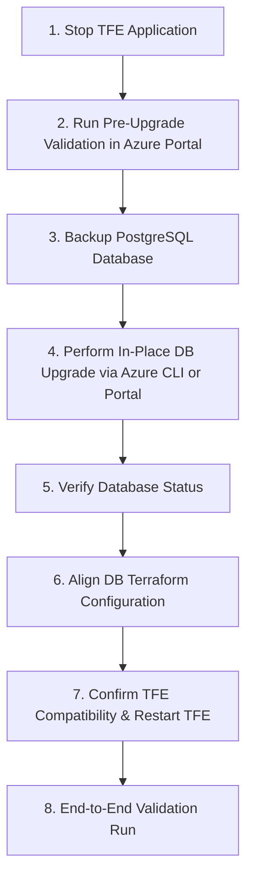

# PostgreSQL Database Major Version Upgrade Guide

This guide details the procedure for performing an in-place major version upgrade of the **Azure Database for PostgreSQL Flexible Server** used by Terraform Enterprise (TFE).

---

> ⚠️ **CRITICAL REQUIREMENT & CAVEAT**
>
> **All database upgrade procedures MUST be fully tested and rehearsed in a dedicated Development / Sandbox environment before being applied to Production.**
>
> Major PostgreSQL upgrades perform schema rewrites and can affect extension compatibility (`CITEXT`, `HSTORE`, `UUID-OSSP`). Always verify backups, maintenance windows, and database connectivity in non-prod prior to initiating production upgrades.

---

## Architecture & Compatibility Principles

- **TFE Version Compatibility:** TFE Flexible Deployments officially support PostgreSQL **12, 13, 14, 15, 16, 17, and 18** (refer to [TFE System Requirements](https://developer.hashicorp.com/terraform/enterprise/flexible-deployments/requirements/system-requirements#postgresql)).
- **In-Place Azure Upgrade:** Azure Database for PostgreSQL Flexible Server supports in-place major version upgrades without data migration or re-provisioning.
- **Mandatory Extensions:** TFE requires `CITEXT`, `HSTORE`, and `UUID-OSSP` extensions to remain active after the upgrade.

---

## Upgrade Workflow



---

## Step-by-Step Procedure

### Step 1: Stop TFE Application

To prevent data corruption and ensure no active writes or connections occur against the database during backup and upgrade, stop or quiesce TFE using one of the following three options based on your operational preference:

#### Option 1: Scale the Azure VMSS to 0 VMs (Full Infrastructure Stop)
Scale down the Virtual Machine Scale Set to zero instances and ensure health probe checks are disabled:

```bash
# 1. Temporarily detach the health probe from VMSS
az vmss update \
  --resource-group tfe-rg \
  --name em-tfe-vmss \
  --remove healthProbeId

# 2. Scale VMSS instance count to 0
az vmss scale \
  --resource-group tfe-rg \
  --name em-tfe-vmss \
  --new-capacity 0
```
*(Alternatively, set `vmss_instance_count = 0` in `main/terraform.tfvars` and run `terraform apply`).*

#### Option 2: Stop TFE via Docker Compose (docker compose down)
If keeping the VM instances running, stop all TFE application containers completely:

```bash
# Run on the TFE VM host
sudo docker compose --file /etc/tfe/docker-compose.yaml down
```
*(For Podman: `sudo systemctl stop tfe.service`).*

#### Option 3: Gracefully Drain Node Connections (Soft Quiesce)
If you want the application to finish active in-flight runs and cleanly reject new ones:

```bash
# Run from the TFE VM host
sudo docker compose --file /etc/tfe/docker-compose.yaml exec tfe bash -l -c "tfectl node drain --all"

# Verify node state
sudo docker compose --file /etc/tfe/docker-compose.yaml exec tfe bash -l -c "tfectl node list"
```

---

### Step 2: Run a Pre-Upgrade Validation (Azure Portal)

Run Azure's built-in pre-upgrade validation before taking the backup. It checks the server for issues that would block or break the major version upgrade (for example, unsupported extensions or incompatible settings) without changing anything.

1. In the Azure Portal, open your **Azure Database for PostgreSQL flexible server** (e.g. `em-tfe-postgres-primary`).
2. Click **Upgrade**.
3. Choose the target major version (e.g. `18`) and select **Validate** (pre-upgrade validation). Do **not** select **Upgrade** yet.
4. Review the result. Resolve every reported error (and review warnings) before continuing.

> **Note:** There is no `az postgres flexible-server` CLI command for the pre-upgrade validation. The only CLI command is `az postgres flexible-server upgrade`, which starts the real upgrade. Use the portal for validation. The exact portal labels may vary as the feature evolves.
>
> Also confirm that `citext`, `hstore` and `uuid-ossp` are allow-listed in the server's `azure.extensions` parameter, since TFE requires them.

---

### Step 3: Backup the PostgreSQL Database

Capture both an Azure snapshot backup and an offline SQL dump. Replace resource names with your `terraform.tfvars` values:

1. **Azure Snapshot Backup:**
   ```bash
   az postgres flexible-server backup create \
     --resource-group tfe-rg \
     --name em-tfe-postgres-primary \
     --backup-name "pre-upgrade-pg-$(date +%Y%m%d)"
   ```

2. **Offline SQL Dump (via Ubuntu Bastion):**
   ```bash
   export PGPASSWORD=$(az keyvault secret show \
     --id "https://em-bootstrap-kv.vault.azure.net/secrets/tfe-database-password" \
     --query value -o tsv)

   pg_dump -h em-tfe-postgres-primary.postgres.database.azure.com \
     -U tfeadmin -d tfe -Fc -f "tfe-pre-upgrade-$(date +%Y%m%d).dump"

   unset PGPASSWORD
   ```

---

### Step 4: Perform In-Place Major Version Upgrade

1. **Trigger the upgrade** using one of the following options:

   **Option A: Azure Portal (GUI)**
   1. In the [Azure Portal](https://portal.azure.com), open your **Azure Database for PostgreSQL flexible server** (e.g. `em-tfe-postgres-primary`).
   2. Go to **Overview** and select **Upgrade** (or **Settings → Compute + storage**, depending on the portal layout).
   3. Select the target major version (e.g. `18`).
   4. Confirm the prompt and select **Upgrade** to start.

   **Option B: Azure CLI**
   ```bash
   az postgres flexible-server upgrade \
     --resource-group tfe-rg \
     --name em-tfe-postgres-primary \
     --version 18
   ```

2. **Monitor Server State** (CLI, or the server's **Overview** page in the portal):
   ```bash
   az postgres flexible-server show \
     --resource-group tfe-rg \
     --name em-tfe-postgres-primary \
     --query "{Name:name, Version:version, State:userVisibleState}" \
     --output table
   ```
   *Wait until the state transitions to `Ready`.*

---

### Step 5: Verify Database Status

Verify the database has finished upgrading and is healthy. In the Azure Portal, open the server's **Overview** page and confirm the status is `Ready` and the version shows the new major version. Or use the CLI:

```bash
az postgres flexible-server show \
  --resource-group tfe-rg \
  --name em-tfe-postgres-primary \
  --query "{Name:name, Version:version, State:userVisibleState}" \
  --output table
```

---

### Step 6: Align Database Terraform Configuration

Update `postgres_version` in [`main/terraform.tfvars`](../main/terraform.tfvars):
```hcl
postgres_version = 18
```

Apply Terraform:
```bash
cd main/
terraform plan
terraform apply
```

> **Note:** Terraform may show that the database is being upgraded. This is expected: the upgrade has already been performed in Step 4, so applying only updates the Terraform state to reflect the new database version.
>
> ⚠️ **Check the plan before applying.** Confirm that the database is **not** being destroyed and recreated (shown as `-/+` or "must be replaced"). The change must only be an **update in-place** (`~`). If the plan shows the database being replaced, **do not apply**, and investigate first.

---

### Step 7: Confirm TFE Compatibility and Restart / Resume TFE

Ensure that your TFE version supports the database version you have upgraded to (see the [TFE System Requirements](https://developer.hashicorp.com/terraform/enterprise/flexible-deployments/requirements/system-requirements#postgresql)). If it does not, upgrade TFE before starting it against the new database.

Then bring TFE back up based on the option chosen in Step 1:

- **If you scaled VMSS to 0 (Option 1):** Scale the VMSS back up and re-attach the health probe:
  ```bash
  # Scale back to desired instance count (e.g., 1 or 2)
  az vmss scale --resource-group tfe-rg --name em-tfe-vmss --new-capacity 1

  # Re-apply Terraform to restore health probe binding cleanly
  cd main/ && terraform apply
  ```

- **If you ran `docker compose down` (Option 2):** Start the containers in the background:
  ```bash
  sudo docker compose --file /etc/tfe/docker-compose.yaml up -d
  ```

- **If you drained connections (Option 3):** Restart the container to clear the drain state and reconnect:
  ```bash
  sudo docker compose --file /etc/tfe/docker-compose.yaml restart
  ```

---

### Step 8: End-to-End Validation Run

Verify TFE by running a plan and apply, and verify the logs.

---

## Rollback & Recovery Plan

> ⚠️ **This rollback plan must be fully tested** in a Development / Sandbox environment before it is relied on in Production.

If issues occur after upgrading the database:

1. **Restore from a Backup via the Azure Portal (GUI):**
   Azure restores a flexible server to a **new server**. It does not overwrite the existing one.
   1. In the Azure Portal, open your **Azure Database for PostgreSQL flexible server** (e.g. `em-tfe-postgres-primary`).
   2. Click **Restore**.
   3. Select the restore point: the **latest restore point**, or a **specific restore point** taken before the upgrade (for example, the time of the Step 3 backup).
   4. Enter a name for the new server (e.g. `em-tfe-postgres-restored`).
   5. Confirm the networking settings (VNet / subnet and private DNS zone) match the original server, so TFE can reach the restored server.
   6. Click **Review + create**, then **Create**, and wait for the new server to show as `Ready`.
   7. Verify the restored server's version and that the `citext`, `hstore` and `uuid-ossp` extensions are present.
   8. Point TFE at the restored server (update the database host in the TFE / Terraform configuration), then restart TFE and verify with a plan and apply.

   > **Note:** The exact portal labels may vary as the feature evolves. Terraform state will no longer match the restored server, so review the Terraform plan carefully before applying.

2. **Point-in-Time Restore to a New Server (CLI):**
   ```bash
   az postgres flexible-server restore \
     --resource-group tfe-rg \
     --name em-tfe-postgres-restored \
     --source-server em-tfe-postgres-primary \
     --restore-time "<restore_timestamp_iso8601>"
   ```
3. **Restore from Offline Dump:**
   Deploy a fresh server on the previous version and restore using `pg_restore`:
   ```bash
   pg_restore -h <restored-server-fqdn> -U tfeadmin -d tfe -v "tfe-pre-upgrade-<date>.dump"
   ```
