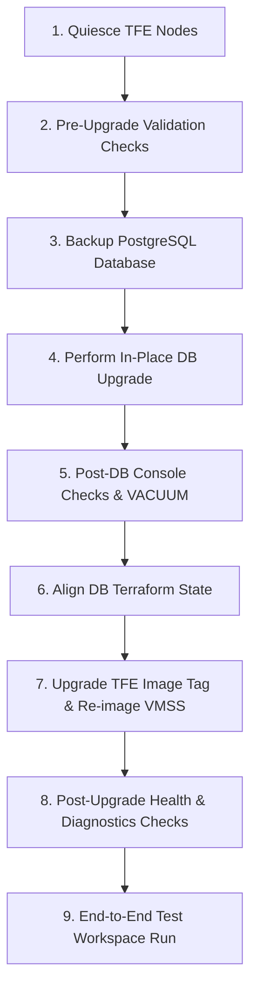

# Terraform Enterprise (TFE) and PostgreSQL Database Upgrade Guide

This guide details the end-to-end procedure for performing version upgrades of both **Terraform Enterprise (TFE)** and the backing **Azure Database for PostgreSQL Flexible Server**, including validation checks, troubleshooting steps, and recovery plans.

---

> ⚠️ **CRITICAL REQUIREMENT & CAVEAT**
>
> **All upgrade procedures outlined in this guide MUST be fully tested and rehearsed in a dedicated Development / Sandbox environment before being applied to Production.**
>
> Database schema migrations, extension compatibility (`CITEXT`, `HSTORE`, `UUID-OSSP`), and sequential TFE milestone version hops can cause irreversible changes to application state. Always ensure fresh backups exist, maintenance windows are scheduled, and end-to-end workspace validation passes in non-prod prior to initiating production upgrades.

---

## Architecture & Upgrade Principles

- **Stateless & Immutable TFE Nodes:** TFE application data is completely decoupled from the VM instances into Azure PostgreSQL and Azure Blob Storage. TFE version upgrades are performed by re-imaging the Azure Virtual Machine Scale Set (VMSS) instances with the new container image tag.
- **In-Place Database Upgrades:** Azure Database for PostgreSQL Flexible Server supports in-place major version upgrades via Azure CLI / Portal.
- **Sequential TFE Upgrade Hops:** When upgrading across multiple releases, you **must not skip intermediate required milestone releases** (denoted with an asterisk `*` in the [TFE Releases Matrix](https://developer.hashicorp.com/terraform/enterprise/releases)) to allow database schema migrations to execute in order.

---

## Upgrade Workflow



---

## Pre-Upgrade Planning & Version Matrix

1. **Check TFE & PostgreSQL Compatibility:**
   - Refer to [TFE System Requirements](https://developer.hashicorp.com/terraform/enterprise/flexible-deployments/requirements/system-requirements#postgresql).
   - TFE Flexible Deployments officially support PostgreSQL **12, 13, 14, 15, and 16**.
2. **Review TFE Upgrade Sequence:**
   If upgrading from older releases (e.g., `1.0.1`), execute sequential hops through required migration versions before reaching the target version:
   ```text
   1.0.1 (Current) ➔ v202408-1* ➔ v202410-1* ➔ v202412-1* ➔ Target Release
   ```

---

## Step-by-Step Upgrade Procedure

### Step 1: Quiesce TFE Application

Gracefully drain all nodes to stop processing new plans and applies and ensure no writes occur during backups:

From the TFE VM host:

**Docker Compose:**
```bash
sudo docker compose --file /etc/tfe/docker-compose.yaml exec tfe bash -l -c "tfectl node drain --all"
```

**Podman:**
```bash
sudo podman exec -it $(sudo podman ps -qf "name=tfe") bash -l -c "tfectl node drain --all"
```

Verify active node registration:
```bash
sudo docker compose --file /etc/tfe/docker-compose.yaml exec tfe bash -l -c "tfectl node list"
```

---

### Step 2: Pre-Upgrade Console Validation (Baseline)

Connect to PostgreSQL via `psql` from the [Ubuntu bastion](ubuntu_bastion.tf) or any host inside the VNet:

```bash
export PGPASSWORD=$(az keyvault secret show \
  --id "https://em-bootstrap-kv.vault.azure.net/secrets/tfe-database-password" \
  --query value -o tsv)

# Connect to database
psql -h em-tfe-postgres-primary.postgres.database.azure.com -U tfeadmin -d tfe
```

Inside the `psql` console, run baseline queries:

```sql
-- 1. Check current PostgreSQL engine version
SELECT version();

-- 2. Verify installed extensions
SELECT extname, extversion FROM pg_extension WHERE extname IN ('citext', 'hstore', 'uuid-ossp');

-- 3. Record baseline table count
SELECT count(*) AS total_tables FROM information_schema.tables WHERE table_schema = 'public';

-- 4. Verify no blocking client connections
SELECT pid, usename, client_addr, state, query FROM pg_stat_activity WHERE datname = 'tfe';

-- 5. Exit
\q
```

```bash
unset PGPASSWORD
```

---

### Step 3: Backup the PostgreSQL Database

Capture both an Azure snapshot backup and an offline SQL dump. Replace resource names with your `terraform.tfvars` values:

1. **Create an on-demand Azure snapshot backup:**
   ```bash
   az postgres flexible-server backup create \
     --resource-group tfe-rg \
     --name em-tfe-postgres-primary \
     --backup-name "pre-upgrade-pg-$(date +%Y%m%d)"
   ```

2. **(Recommended) Take an offline SQL dump via Ubuntu Bastion:**
   ```bash
   export PGPASSWORD=$(az keyvault secret show \
     --id "https://em-bootstrap-kv.vault.azure.net/secrets/tfe-database-password" \
     --query value -o tsv)

   pg_dump -h em-tfe-postgres-primary.postgres.database.azure.com \
     -U tfeadmin \
     -d tfe \
     -Fc \
     -f "tfe-pre-upgrade-$(date +%Y%m%d).dump"

   unset PGPASSWORD
   ```

---

### Step 4: Perform PostgreSQL In-Place Major Version Upgrade

1. **Execute in-place upgrade via Azure CLI:**
   ```bash
   az postgres flexible-server upgrade \
     --resource-group tfe-rg \
     --name em-tfe-postgres-primary \
     --target-major-version 16
   ```

2. **Monitor until status is `Ready`:**
   ```bash
   az postgres flexible-server show \
     --resource-group tfe-rg \
     --name em-tfe-postgres-primary \
     --query "{Name:name, Version:version, State:userVisibleState}" \
     --output table
   ```

---

### Step 5: Post-DB Upgrade Console Checks & Optimization

Once Azure reports the database is `Ready`, connect via `psql` from the Ubuntu bastion:

```bash
export PGPASSWORD=$(az keyvault secret show \
  --id "https://em-bootstrap-kv.vault.azure.net/secrets/tfe-database-password" \
  --query value -o tsv)

psql -h em-tfe-postgres-primary.postgres.database.azure.com -U tfeadmin -d tfe
```

Inside `psql`:

```sql
-- 1. Confirm new engine version
SELECT version();

-- 2. Ensure all required extensions remain active
CREATE EXTENSION IF NOT EXISTS citext;
CREATE EXTENSION IF NOT EXISTS hstore;
CREATE EXTENSION IF NOT EXISTS "uuid-ossp";

-- 3. Verify total table count matches baseline
SELECT count(*) AS total_tables FROM information_schema.tables WHERE table_schema = 'public';

-- 4. Check for invalid indexes
SELECT schemaname, relname, indexrelname FROM pg_stat_user_indexes JOIN pg_index USING (indexrelid) WHERE indisvalid = false;

-- 5. Re-generate query planner optimizer statistics (MANDATORY after major version upgrade)
VACUUM ANALYZE;

-- 6. Exit
\q
```

```bash
unset PGPASSWORD
```

---

### Step 6: Align Database Terraform Configuration

Update `postgres_version` in `main/terraform.tfvars` to match the upgraded server version:

```hcl
postgres_version = 16
```

Apply Terraform to sync state:
```bash
cd main/
terraform plan
terraform apply
```

---

### Step 7: Perform TFE Version Upgrade & Re-image VMSS

1. **Update `tfe_image_tag` in `main/terraform.tfvars`:**
   ```hcl
   tfe_image_tag = "v202408-1" # (or next milestone version in sequence)
   ```

2. **Apply Terraform:**
   ```bash
   terraform apply
   ```
   *(The module uses dynamic health probe hashes with `create_before_destroy = true` in [`load_balancer.tf`](../load_balancer.tf) to seamlessly update the Azure Load Balancer probe without `CannotModifyProbeUsedByVMSS` errors).*

3. **Re-image VMSS Instances with New Configuration:**
   Instruct Azure VMSS to roll out the new cloud-init and container image to all instances:
   ```bash
   az vmss update-instances \
     --resource-group tfe-rg \
     --name em-tfe-vmss \
     --instance-ids "*"
   ```

---

### Step 8: Post-Upgrade Diagnostics & Health Checks

Once the VMSS instance boots, run the following verification checks from the TFE VM host:

#### 1. Validate Active TFE Nodes
```bash
sudo docker compose --file /etc/tfe/docker-compose.yaml exec tfe bash -l -c "tfectl node list"
```

#### 2. Check Overall TFE Health & Subsystem Readiness
```bash
curl -k -fsS https://127.0.0.1/api/v1/health/readiness
```
*Expected Output:*
```json
{"node":"...","status":"OK","checks":[{"check":"archivist","status":"OK"},{"check":"atlas","status":"OK"},{"check":"database","status":"OK"},{"check":"redis","status":"OK"},{"check":"task-worker","status":"OK"},{"check":"vault","status":"OK"}]}
```

#### 3. Verify Database & ActiveRecord Connection Logs
Confirm that Rails connected cleanly to PostgreSQL without startup validation failures:
```bash
sudo docker compose --file /etc/tfe/docker-compose.yaml logs tfe | grep -i -E "postgres|database|pg::|active_record" | tail -n 50
```

#### 4. Verify Fluent Bit Log Forwarding (Log Analytics & Event Hub)
```bash
# Check Fluent Bit health endpoint
sudo docker compose --file /etc/tfe/docker-compose.yaml exec tfe curl -fsS http://127.0.0.1:2020/api/v1/health
# Expected: ok

# Check Fluent Bit output metrics (verify zero output errors)
sudo docker compose --file /etc/tfe/docker-compose.yaml exec tfe curl -fsS http://127.0.0.1:2020/api/v1/metrics
```

#### 5. Verify Rails Console Model Queries
```bash
sudo docker compose --file /etc/tfe/docker-compose.yaml exec tfe bash -l -c "tfe-console"
```
```ruby
# Verify active connection & query record counts
ActiveRecord::Base.connection.active?
Organization.count
Workspace.count
User.count
exit
```

---

### Step 9: End-to-End Validation Run

1. **Verify UI via Browser:**
   Connect to the [Ubuntu bastion](ubuntu_bastion.tf) via RDP and navigate to `https://<tfe_fqdn>` in Chrome:
   - Check **Site Admin** → **Health / Diagnostics** (confirm all checks green).
   - Check **Site Admin** → **Version Information** (confirm upgraded version tag).

2. **Execute Test Workspace Run:**
   Run an end-to-end Terraform plan and apply against TFE:
   ```bash
   export SSH_KEY=~/.ssh/<your-private-key>
   export TFE_ORG=<your-org-name>
   export TFE_TOKEN=<your-user-api-token>

   bash scripts/run-test-workspace.sh
   ```

---

## Rollback & Disaster Recovery Procedures

If unresolvable errors occur during database or application upgrades:

### Rollback Database:
```bash
az postgres flexible-server restore \
  --resource-group tfe-rg \
  --name em-tfe-postgres-restored \
  --source-server em-tfe-postgres-primary \
  --restore-time "<timestamp_before_upgrade_iso8601>"
```

### Rollback TFE Image:
1. Revert `tfe_image_tag` in `main/terraform.tfvars` to previous version.
2. Run `terraform apply`.
3. Run `az vmss update-instances --resource-group tfe-rg --name em-tfe-vmss --instance-ids "*"`.
