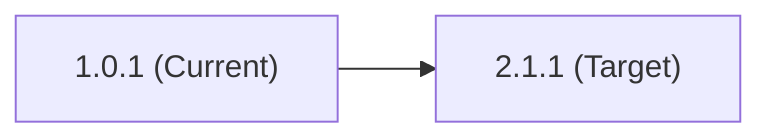
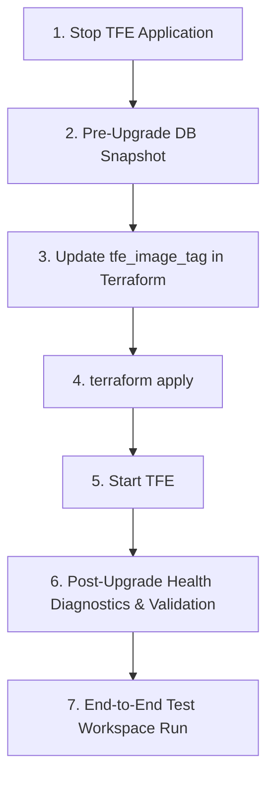

# Terraform Enterprise (TFE) Version Upgrade Guide

This guide details the procedure for performing version upgrades of the **Terraform Enterprise (TFE)** application deployed on the Azure Virtual Machine Scale Set (VMSS).

---

> ⚠️ **CRITICAL REQUIREMENT & CAVEAT**
>
> **All TFE version upgrades MUST be fully tested and rehearsed in a dedicated Development / Sandbox environment before being applied to Production.**
>
> When upgrading across major or minor releases, database schema migrations run automatically upon boot. Always take a safety database snapshot before upgrading, and validate workspace execution in non-prod prior to initiating production upgrades.

---

## Architecture & Upgrade Principles

- **Stateless & Immutable TFE Nodes:** TFE application data is completely decoupled from the VM instances into Azure PostgreSQL and Azure Blob Storage. Upgrades involve re-imaging the VMSS instances with the new container image tag rather than in-place host modification.
- **Direct Upgrades:** An upgrade can be performed directly from TFE `1.0.1` to TFE `2.1.1`; no intermediate version hops are required.
- **Dynamic Load Balancer Probe Updates:** The module automatically generates a unique probe hash with `create_before_destroy = true` in [`load_balancer.tf`](../load_balancer.tf) to switch probe paths (`/_health_check` to `/api/v1/health/readiness`) without Azure VMSS probe modification locks.

---

## Sequential Version Hops Matrix

An upgrade can be performed directly from TFE `1.0.1` to TFE `2.1.1`. **No intermediate hops are required.**



| Hop | `tfe_image_tag` | Notes |
| :---: | :--- | :--- |
| **0** | `1.0.1` | Starting baseline version |
| **1** | `2.1.1` | Target release (direct upgrade, no intermediate hops required) |

---

## Upgrade Workflow



---

## Step-by-Step Procedure

### Step 1: Stop TFE Application

To prevent data corruption and ensure no active runs or connections occur while the TFE image is upgraded, stop or quiesce TFE using one of the following three options based on your operational preference:

#### Option 1: Scale the Azure VMSS to 0 VMs (Full Infrastructure Stop)
Scale down the Virtual Machine Scale Set to zero instances and ensure health probe checks are disabled:

```bash
# 1. Temporarily detach the health probe from VMSS
az vmss update \
  --resource-group tfe-rg \
  --name em-tfe-vmss \
  --remove healthProbeId

# 2. Scale VMSS instance count to 0
az vmss scale \
  --resource-group tfe-rg \
  --name em-tfe-vmss \
  --new-capacity 0
```
*(Alternatively, set `vmss_instance_count = 0` in `main/terraform.tfvars` and run `terraform apply`).*

#### Option 2: Stop TFE via Docker Compose (`docker compose down`)
If keeping the VM instances running, stop all TFE application containers completely:

```bash
# Run on the TFE VM host
sudo docker compose --file /etc/tfe/docker-compose.yaml down
```
*(For Podman: `sudo systemctl stop tfe.service`).*

#### Option 3: Gracefully Drain Node Connections (Soft Quiesce)
If you want the application to finish active in-flight runs and cleanly reject new ones:

```bash
# Run from the TFE VM host
sudo docker compose --file /etc/tfe/docker-compose.yaml exec tfe bash -l -c "tfectl node drain --all"

# Verify node state
sudo docker compose --file /etc/tfe/docker-compose.yaml exec tfe bash -l -c "tfectl node list"
```

---

### Step 2: Capture a Database Safety Snapshot

Before applying the new TFE container image (which runs schema migrations), capture a snapshot:

```bash
az postgres flexible-server backup create \
  --resource-group tfe-rg \
  --name em-tfe-postgres-primary \
  --backup-name "pre-tfe-upgrade-$(date +%Y%m%d%H%M)"
```

---

### Step 3: Update `tfe_image_tag` in Terraform Configuration

In [`main/terraform.tfvars`](../main/terraform.tfvars), set `tfe_image_tag` to the target version:

```hcl
tfe_image_tag = "2.1.1" # Target version
```

---

### Step 4: Apply Terraform Configuration

```bash
cd main/
terraform apply
```

*(The module creates the new probe first and updates the VMSS binding seamlessly without conflict).*

---

### Step 5: Start TFE

Start TFE on the new image tag, based on the option chosen in Step 1. The VMSS uses `upgrade_mode = "Manual"`, so `terraform apply` alone does not change running instances.

- **If you scaled VMSS to 0 (Option 1):** Scale the VMSS back up. New instances are created from the updated model (new `tfe_image_tag`). Then re-apply Terraform to restore the health probe binding:
  ```bash
  # Scale back to desired instance count (e.g., 1 or 2)
  az vmss scale --resource-group tfe-rg --name em-tfe-vmss --new-capacity 1

  # Re-apply Terraform to restore health probe binding cleanly
  cd main/ && terraform apply
  ```

- **If you ran `docker compose down` (Option 2) or drained nodes (Option 3):** The instances are still running with the old image tag. Roll out the updated cloud-init and container image to all instances:
  ```bash
  az vmss update-instances \
    --resource-group tfe-rg \
    --name em-tfe-vmss \
    --instance-ids "*"
  ```

---

### Step 6: Post-Upgrade Health Diagnostics & Validation

Wait ~1–2 minutes for the VMSS instances to boot, pull the image, and complete schema migrations. Then run the diagnostic suite from the TFE VM host:

1. **Verify Active Node Registration:**
   ```bash
   sudo docker compose --file /etc/tfe/docker-compose.yaml exec tfe bash -l -c "tfectl node list"
   ```

2. **Check Application Health & Subsystem Readiness:**
   ```bash
   curl -k -fsS https://127.0.0.1/api/v1/health/readiness
   ```
   *Expected response:*
   ```json
   {"node":"...","status":"OK","checks":[{"check":"archivist","status":"OK"},{"check":"atlas","status":"OK"},{"check":"database","status":"OK"},{"check":"redis","status":"OK"},{"check":"task-worker","status":"OK"},{"check":"vault","status":"OK"}]}
   ```

3. **Verify Database Connection & ActiveRecord Logs:**
   ```bash
   sudo docker compose --file /etc/tfe/docker-compose.yaml logs tfe | grep -i -E "postgres|database|pg::|active_record" | tail -n 50
   ```

4. **Verify Fluent Bit Log Forwarding (Log Analytics & Event Hub):**
   ```bash
   # Check Fluent Bit internal health
   sudo docker compose --file /etc/tfe/docker-compose.yaml exec tfe curl -fsS http://127.0.0.1:2020/api/v1/health
   # Expected: ok

   # Check Fluent Bit metrics (verify 0 errors)
   sudo docker compose --file /etc/tfe/docker-compose.yaml exec tfe curl -fsS http://127.0.0.1:2020/api/v1/metrics
   ```

5. **Verify Rails Console Model Queries:**
   ```bash
   sudo docker compose --file /etc/tfe/docker-compose.yaml exec tfe bash -l -c "tfe-console"
   ```
   ```ruby
   ActiveRecord::Base.connection.active?
   Organization.count
   Workspace.count
   User.count
   exit
   ```

*Once all diagnostics pass, proceed to the end-to-end validation run.*

---

### Step 7: End-to-End Validation Run

Once on the target release:

1. **Log in via the UI:** Log in to the TFE UI, test a plan and apply, and verify that features are working as expected.

2. **Test via the CLI:** Test a plan and apply via the CLI.

---

## Rollback & Recovery Plan

> ⚠️ **This rollback plan must be fully tested** in a Development / Sandbox environment before it is relied on in Production.

If a specific TFE release fails to start or schema migrations encounter errors:

1. **Restore the database:** Restore the database from the snapshot taken in Step 2.
2. **Revert the image tag:** Set `tfe_image_tag` back to the previous version.
3. **Plan and apply the image tag change:** Run a Terraform plan and apply to roll out the reverted `tfe_image_tag`.
4. **Restart TFE and verify:** Restart TFE on the previous version, then run a test plan and apply to verify that it is working as expected.
